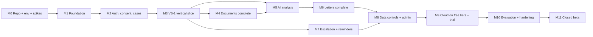

# ClaimSathi: Implementation Backlog

| Field | Value |
|---|---|
| Date | 15 October 2026 |
| Sources | PRD v1.1 §12 (epics), system-design v1.1 §C.10 (stages), testing-strategy §2 (test IDs), development-readiness §4 (decisions) |
| Status | **In progress (15 Oct 2026).** Development authorised (readiness §9). M0–M3 code exists; see §0 for task status. |

## 0. Progress (15 October 2026)

Evidence (16 Oct 2026):

- **Backend:** 69 tests passed and 1 failed against PostgreSQL 18. The failure is the PDF render on native Windows (OI-03), which now returns 503 `export_unavailable`. ruff, mypy and `alembic check` are clean.
- **Web:** lint, typecheck, 15 Vitest tests and `next build` pass.
- **Browser E2E (Playwright, local):** 4 of 5 journeys pass, covering a rejected claim, manual entry, sign-out and Gujarati. The partly-paid journey stops only at the PDF download (OI-03).
- **CI** gains an `e2e` job on Linux, where the PDF render works. CI has not run yet because the code is not pushed.

| Task | Status | Notes |
|---|---|---|
| T-001, T-005 | Done | |
| T-002 | Done, except `packages/design-tokens` | Tokens live as CSS variables in `apps/web/app/globals.css` |
| T-003 | Written, **not verified** | Docker engine would not start. No `clamd` yet (M4). Images not yet pinned by digest. |
| T-004 | Written, **not run** | Runs on the first push. The web audit step will fail until OI-01 is decided. |
| S-1, S-2, S-5 | Not started | S-2 default applied (upload through the API). S-5 needs a Gemini dev key (synthetic data only). |
| T-101, T-103, T-106, T-110, T-111 | Done | |
| T-102 | Done, except Sentry | |
| T-104 | Done, except `/readyz` | |
| T-105 | Done, except web `script-src` | OI-02 |
| T-107 | Not started | |
| T-108 | Done, except the progress ETag | |
| T-109 | Partial | `ObjectStore` (S3 and memory); no signed GET URLs yet (downloads go through the API) |
| T-112 | Done with in-house i18n | gu and hi strings are drafts awaiting native review; no axe check yet |
| T-201, T-203 | Done | |
| T-202, T-205 | Not started | The authorization matrix is a hand-written test, not generated from OpenAPI |
| T-204 | Done, except case PATCH | |
| T-301 to T-304, T-306 | Done (fake AI) | |
| T-305 | Partial | Synthetic text fixtures only; no PDF ingestion CLI and no real Master Circular yet |
| T-307 | Done; PDF export unverified locally | OI-03 |
| T-308 | Done, except the manual `gemini_dev` run | `apps/web/e2e/` covers partly paid (SYN-001), rejection (SYN-002), manual entry, sign-out and Gujarati |
| Post-VS-1 fixes | Done | Listed in the 16 Oct audit fixes below |
| M7: FR-020 to FR-023 (17 Oct 2026) | Done, except SES (M9) and the Ombudsman pack (FR-026) | Migration 0002 adds `case_events`, `deadlines`, `reminders` and `rule_acknowledgements`. RULE-ESC-01..06 and RULE-DEADLINES are seeded: enabled locally pending legal review (OQ-10), `disabled_pending_verification` in prod. The deterministic engine is `rules/escalation.py`. API: `/escalation`, `/events`, `/deadlines.ics`, `/notifications`. Screens: Track (CASE-07) and Ombudsman checks (CASE-09). A local reminder ticker stands in for Cloud Scheduler. Tests: 20 unit, 10 integration, 1 browser. |
| M8: FR-030 to FR-036 (17 Oct 2026) | Done, except FR-042 support access, nickname edit, and the 30-day email tombstone (OI-04) | Migration 0003 adds `data_exports`, report fields on `review_items` and email change on `email_challenges`. Delete case and delete account use a 4-digit typed confirmation (DD-10), hard-delete storage, rows, job rows and cached replies, and keep a content-free audit row. Data export ZIP is valid 24 h. Retention: closed-case files go after 90 days (extendable once); inactive open cases get a notice at 18 months and are deleted 30 days later. Outcome capture (CASE-11), "Something's wrong?" reports (FR-035), account settings (ACC-01/02) and case settings (CASE-12). |
| FR-026 Ombudsman pack, FR-028 copy as text (17 Oct 2026) | Done (generic pack per OQ-02 default) | `POST/GET /cases/{id}/packs/ombudsman` re-check RULE-ESC server-side and need every warning acknowledged. The S3 letter reuses the S1 grounds plus a grievance history built from the logged event dates (AC2) and an enclosure list. CASE-10 screen: signatory notice, letter, enclosures, free filing via cioins.co.in, "Log that I filed". "Copy as email text" on both letters. CIO form fields wait on OQ-02. DOCX export: done 17 Oct (python-docx 1.2.0). A4 with Noto Serif; citations become [n] markers plus a numbered Sources list, because python-docx cannot write native Word footnotes; exports are audit-logged (AC3). Word export also works on native Windows, unlike PDF (OI-03). |
| FR-027 letter editing (17 Oct 2026) | Done (block editor) | `PATCH /letters/{id}`: a quote stays verified only if its text is exactly the generated verified quote. An edited quote becomes plain text and loses its footnote in the screen and the PDF (AC1); undo restores it (AC2); autosave runs every 10 s and on blur (AC3); every edit needs a new review. This block editor replaces a TipTap rich-text editor (no new dependency). |
| FR-013/016/018 and FR-043/044 (17 Oct 2026) | Done | User-picked reason categories drive the deterministic RULE-MC-02/03/05. The evidence checklist (draft map, pending review D-H) feeds the letters' enclosures. Information pages in en/gu/hi: how it works, what we don't do, free official channels (verified, S64), accuracy (empty state until an audit exists), and privacy/terms/contact (DRAFT pending legal review CI-07; grievance officer pending OQ-13). A footer on every page puts free help one tap away. |
| FR-002 Google sign-in (17 Oct 2026) | Done; needs the product owner's free OAuth client ID to switch on | Migration 0005 adds `oauth_identities`. `GET /auth/google/start` and `/callback` implement OIDC with PKCE, state and nonce; `email_verified` is required. Accounts link by verified email with email-code sign-in (AC3), and a cancel returns quietly to sign-in (AC2). `GET /auth/providers` hides the button until configured. Setup is in development-setup §3b. |
| FR-037, FR-040, FR-042 admin console: stage 1 (17 Oct 2026) | Done; rules (FR-039) and knowledge base (FR-038) screens are next | Migration 0006 adds `admin_users`, admin sessions, `support_grants` and reviewer decisions. Admin sign-in is an allowlisted Google account (seeded from `ADMIN_BOOTSTRAP_EMAIL`) plus mandatory TOTP with enrolment; 5 wrong codes in 15 minutes lock the account for 15 minutes; sessions last 8 hours. Consumer and admin sessions never cross (AC1). The review queue supports decisions. Case content needs the user's 7-day grant: without it the API returns 403 and logs the attempt; grants expire by themselves. The user can grant or revoke access in Case settings or from the report dialog. Every admin action is audited (ids only). |

**16 Oct 2026 audit fixes** (found by browser testing and a frontend–backend contract review):

- **Sign-in:** a valid code bounced the user back to sign-in because `useI18n()` returned new functions on every render. Fixed, along with the repeated `/me` calls it caused.
- **Extraction timing:** Continue no longer opens the details page while extraction is still running. Required fields always show, so a letter the AI can't read can be typed in by hand.
- **Details page:**
  - typed amounts are read as rupees;
  - the decision is chosen with radio buttons;
  - deductions can be added, edited and removed;
  - the page reloads after a version conflict.
- **Rejected claims:** reasons with no clause cited get a finding and a letter. This adds the SYN-002 fixture and its recording.
- **Background tasks:** a crashed task marks its document or analysis as failed instead of leaving it queued, and interrupted tasks resume when the API starts.
- **Account and pages:**
  - sign-out and **My cases** are in the header;
  - pages show a retry instead of loading forever;
  - the source sheet shows an error when a source fails to load;
  - all error messages are translated into en, gu and hi;
  - Accept-Language is read in q order.

**Size key:** **S** is about 1 day or less, **M** about 2–4 days, **L** about 1 week or more. These are ESTIMATES for one developer with AI assistance.

---

## 1. Definition of done (applies to every task)

1. All acceptance criteria are met, with evidence in the pull request: test output, or a screenshot for UI work.
2. The listed tests exist and pass in CI. No gate was skipped or weakened (engineering standards §1).
3. If an endpoint was added or changed: authorization-matrix entries are added and the OpenAPI diff is reviewed.
4. No secrets, PII or document content appear in logs, fixtures or commits (the log-hygiene test passes).
5. UI strings exist in en, gu and hi. The required states are present (design §4).
6. Docs are updated if a documented decision changed.
7. The pull request report lists tests as passed, failed or not run, plus any known limitations.

---

## 2. Milestones and dependencies

**Decision gates by milestone:**

| Milestone | Decision gate |
|---|---|
| Before M1 | D-A, D-D, D-F |
| Before M3 with real AI | S-5 done; synthetic data only |
| Before M5 with real documents | D-B |
| Before M7 | OQ-05 (default kept) |
| Before M9 | D-C, S-1, S-2 |
| Before M11 | Legal review (CI-07); reviewers sourced (CI-20) |

---

## 3. First vertical slice: VS-1 (milestone M3)

**Goal.** Prove one complete user journey across UI, API, database, AI and verification, with **₹0 and no cloud**.

**Journey:**

1. A user signs in with an email code (Mailpit locally) and gives consent (draft text).
2. They create a "partly paid" case.
3. They upload one **text-layer PDF** settlement letter. The fixture is generated from `SYN-001`.
4. They see the extracted facts and four deduction lines, and confirm them.
5. They see the findings:
   - lines L1–L3 marked **"No clause cited"**, each with a **verified citation** to the ingested IRDAI Master Circular Para 17(b) chunk;
   - L4 shown as "Clause cited: Clause 4.7", checked against `SAMPLE-WORDING-001`.
6. They tick "I've read this letter" and download an **English basic-mode Stage-1 letter PDF**. It requests clause references for L1–L3 and states the amounts from the confirmed facts.

**VS-1 acceptance criteria (all must pass):**

| # | Criterion | Evidence |
|---|---|---|
| VS1-1 | The journey completes end to end in Playwright (`SCN-VS1`) with fake AI (recorded responses) | CI E2E run |
| VS1-2 | The same journey completes with `LLM_PROVIDER=gemini_dev` on the **synthetic** fixture, run manually | Run log (no content) + `ai_calls` rows |
| VS1-3 | Extracted amounts equal the fixture ground truth: claimed ₹2,64,820, paid ₹2,10,500, lines summing to ₹54,320. With the fake provider this is deterministic; with Gemini it is reported, not gated. | Test assertion; report |
| VS1-4 | L1–L3 are `NO_CLAUSE_CITED` with 100% precision on the fixture (deterministic) | Rule test RS-FR015 |
| VS1-5 | Every displayed citation passes the verifier. A deliberately corrupted quote (test fixture) is dropped and creates a `review_items` row. | UT-AI004, IT-FR016-1 |
| VS1-6 | The letter contains no amount or date absent from the confirmed facts or cited chunk (number scanner) | UT-AI005 on the letter |
| VS1-7 | Export is refused before review (409 `letter_not_reviewed`) and refused when stale (409 `case_stale`) | API-AI007, IT-FR028-1 |
| VS1-8 | User B cannot read user A's case, document, facts, analysis, letter or export (all 404, identical body) | AZ matrix for the VS-1 endpoints |
| VS1-9 | No fixture identity value (name, policy number) appears in logs or in post-confirmation model payloads | NFR-019 test, SEC-PII-1 |
| VS1-10 | The UI shows ProvenanceTags (document / rule / verified quote). There are no confidence percentages. The ProcessingSteps component shows real steps. | E2E-DAC11 subset, UT-DAC10 |
| VS1-11 | All VS-1 screens render in en, gu and hi (UI shell) with no missing keys | L10N key check |

**Out of scope for VS-1:**

- photos, OCR and ClamAV (M4);
- Google sign-in (T-202, which can run in parallel);
- counter-point generation, translation of letters, escalation and cloud deployment.

---

## 4. Task backlog

**How to read the tables**

- **Reqs** are PRD IDs.
- **Tests** are testing-strategy IDs.
- **Sec** is the security consideration.
- Every task also inherits the definition of done (§1).

### M0: Repository, environment and spikes

| ID | Objective | Reqs | Prereqs | Files / modules | API / DB | Acceptance | Tests | Sec | Size |
|---|---|---|---|---|---|---|---|---|---|
| T-001 | `git init`, `.gitignore`, toolchain pins (`.nvmrc`, `.python-version`, `packageManager`), baseline commit of docs | — | Readiness approved | root files | — | Repository exists; `.env` ignored; baseline commit present | `git check-ignore .env` returns the path | Never commit `.env` | S |
| T-002 | Scaffold `apps/api` (uv, FastAPI, `/healthz`), `apps/web` (`create-next-app@16.4.1`, TS pinned per CI-16, Tailwind v4), `packages/design-tokens` (tokens.json → CSS variables) | NFR-016, NFR-026 | T-001 | `apps/*`, `packages/design-tokens` | `/healthz` | `pnpm dev` and `uvicorn` start; tokens compile to CSS variables | Smoke test on `/healthz`; `tsc --noEmit` | — | M |
| T-003 | `docker-compose.yml`: postgres+pgvector, minio, mailpit, clamd, and an api image with WeasyPrint/Pango and Noto fonts | — | T-002 | `docker-compose.yml`, `apps/api/Dockerfile` | `create extension vector` | `docker compose up` is healthy; the extension loads; a WeasyPrint test PDF renders Gujarati and Devanagari | Compose health check; render test | Images pinned by digest | M |
| T-004 | CI skeleton: ruff, mypy, pytest, eslint, tsc, vitest, gitleaks, pip-audit/osv, npm audit, Docker build | NFR-017 | T-002 | `.github/workflows/ci.yml` | — | CI green on an empty suite; fails on a planted lint error | CI run | gitleaks blocks secrets | M |
| T-005 | Archive the v0 PRD with a superseded banner | — | **D-G** | `docs/archive/` | — | The root has no v0 PRD; the banner links to v1.1 | — | — | S |
| S-1 | Spike: Supabase Free in Mumbai + pgvector + Data API off | UD-12 | Supabase account (free) | `docs/00-governance/spikes/S-1.md` | — | Result recorded (pass or fallback) | Manual | No keys recorded in the doc | S |
| S-2 | Spike: upload path without exposing secret keys | ADR-012 | S-1 | `spikes/S-2.md` | — | A decision is recorded: direct TUS, or proxy through the API (default) | Manual + a throwaway script, not merged | Key exposure analysis | S |
| S-5 | Spike: Gemini 2.5 Flash extraction and quoting on SYN-001…010 (free tier, **synthetic only**) | AI-003, AI-004 | T-002; Gemini dev key | `spikes/S-5.md`, `eval/spike/` | — | Structured-output validity and verifier pass rates reported (indicator, PROVISIONAL ≥ 90% / ≥ 80%) | Script output | Synthetic data only (D-008) | S |

### M1: Application foundation (only what VS-1 needs, plus cross-cutting safety)

| ID | Objective | Reqs | Prereqs | Files / modules | API / DB | Acceptance | Tests | Sec | Size |
|---|---|---|---|---|---|---|---|---|---|
| T-101 | Config with validation (pydantic-settings). Refuses `gemini_dev` when `APP_ENV` is `staging` or `prod`. | AI-014, D-008 | T-002 | `core/config.py` | — | A missing or invalid variable stops start-up with a clear message, without printing values | Unit | Secrets never echoed | S |
| T-102 | Structured logging with a field allowlist + `request_id` + Sentry scrubbing (disabled locally) | NFR-019 | T-101 | `core/logging.py` | — | Unknown log keys fail the test; payloads are never logged | UT-NFR019-1 | Redaction | S |
| T-103 | Problem+json errors + error-code catalogue; identical 404 for missing and not owned | §3.7 | T-101 | `api/errors.py` | — | Every error has a catalogue code; no stack trace in responses | SEC-ERR-1 | No leakage | S |
| T-104 | DB engine, Alembic, first migrations (identity, consent, cases, documents, facts, line items, knowledge, rules, analyses, citations, letters, exports, outbox, `job_steps`, `ai_calls`, idempotency, rate limits, audit); test DB fixtures; `/readyz` | §4.2 | T-003 | `core/db.py`, `migrations/` | All VS-1 tables | `alembic upgrade head` and `alembic check` pass; tests isolated by transaction | MIG-*, IT | Encrypted columns typed as `bytea` | M |
| T-105 | Security middleware: double-submit CSRF + Origin check; cookies; web security headers and CSP | NFR-006 | T-103 | `api/deps.py`, `web/middleware.ts`, `next.config` | — | Unsafe methods without a token get 403; headers present | SEC-CSRF-1, SEC-HDR-1 | CSRF, XSS | S |
| T-106 | Postgres rate limiter + `Idempotency-Key` middleware | §5.1, §5.5 | T-104 | `ratelimit/`, `api/idempotency.py` | `rate_limit_buckets`, `idempotency_keys` | Limit +1 returns 429 + Retry-After; same key and body replays; same key with a different body returns 409 | SEC-RL-*, §3.7 tests | Abuse control | M |
| T-107 | OpenAPI export + TypeScript client generation + CI diff | — | T-103 | `packages/api-client`, CI | — | `pnpm gen:api` is deterministic; CI fails on an unreviewed diff | CI check | — | S |
| T-108 | Outbox + `TaskQueue` facade (in-process implementation) + `job_steps` + `GET /cases/{id}/progress` (ETag) | §3.6 | T-104 | `jobs/` | `outbox`, `job_steps` | A task is enqueued in the same transaction; a duplicate dedupe key runs once; progress shows real steps | IT, §3.7/3.8 tests | Payloads hold IDs only | M |
| T-109 | `ObjectStore` (S3 API → MinIO) + short-lived signed GET URLs | NFR-005 | T-003 | `storage/` | — | A 15-minute URL expires; private bucket | IT-NFR005-2 | No public buckets | S |
| T-110 | `ModelGateway`: Protocol, `fake` (recorded) and `gemini_dev` providers, schema validation + one repair, timeouts, retries, `ai_calls` cost rows, budget-guard hook | AI-003, AI-008, AI-011 | T-104 | `ai/gateway.py`, `ai/providers/` | `ai_calls` | Invalid JSON is repaired once, then fails cleanly; no content in `ai_calls` | IT-AI003, REL-AI008 subset | No tools; content stays out of logs | M |
| T-111 | Field encryption (AES-GCM) + HMAC helpers | NFR-005 | T-101 | `security/crypto.py` | — | Round-trip works; a raw DB read shows ciphertext only | IT-NFR005-1 | Key from config only | S |
| T-112 | Web shell: layouts (Public, Auth, App, Case, Focus), next-intl en/gu/hi + missing-key CI, tokens, LanguageSwitcher, ErrorBoundary, Noto font loading per script | FR-004, NFR-018, NFR-021 | T-002 | `apps/web/app`, `components/layouts` | — | Switching language keeps the route; no missing keys | L10N-NFR021-1, A11Y axe on the shell | — | M |

### M2: Authentication, consent and cases

| ID | Objective | Reqs | Prereqs | Files / modules | API / DB | Acceptance | Tests | Sec | Size |
|---|---|---|---|---|---|---|---|---|---|
| T-201 | Email-code sign-in + sessions + logout / logout-all + `/me`; AUTH-01/02 UI (Google button hidden behind a flag until T-202) | FR-001, FR-003 | M1 | `auth/`, `users/`, web `(public)/sign-in` | `/auth/email/*`, `/me`; `email_challenges`, `sessions`, `users` | PRD FR-001 AC1–AC5; FR-003 AC1–AC2 | API-FR001-1..7, API-FR003-*, SEC-SESS-1, SEC-OTP-1 | No enumeration; constant-time compare | M |
| T-202 | Google OIDC (Authlib) + account linking | FR-002 | T-201 | `auth/google.py` | `/auth/google/*`; `oauth_identities` | FR-002 AC1–AC3 (mock OIDC) | API-FR002-1..5 | PKCE, `state`, `email_verified` required | M |
| T-203 | Consent versions + ONB-01/02 + `ConsentGuard` (API + task) | FR-004, FR-005 | T-201 | `consent/`, web `welcome/*` | `/consent/*`, `/consents*` | FR-005 AC1–AC3; draft notice text marked "PENDING LEGAL" | API-FR005-1..5 | Purpose limitation | M |
| T-204 | Cases: eligibility, create, list, get, patch, open-case cap; APP-01/02/03 UI | FR-006, FR-007 | T-203 | `cases/`, web `cases/*` | `/cases*`; `cases` | FR-006 branches; FR-007 AC1–AC2; concurrent-create test | API-FR006-*, API-FR007-*, IT-FR007-1 | Owner scoping | M |
| T-205 | Authorization-matrix generator from OpenAPI; CI fails if an `{id}` path is missing | NFR-017 | T-204, T-107 | `tests/authz/` | — | Matrix runs for every case-scoped path | AZ-* | BOLA | S |

### M3: VS-1 vertical slice (see §3)

| ID | Objective | Reqs | Prereqs | Files / modules | API / DB | Acceptance | Tests | Sec | Size |
|---|---|---|---|---|---|---|---|---|---|
| T-301 | Upload a **PDF through the API** (CI-04 default) with magic-byte check, size and case caps, duplicate hash, global storage guard (D-E); CASE-01 (PDF only) | FR-008 (subset), FR-009 | T-204, T-109 | `documents/`, web `cases/[id]/documents` | `/cases/{id}/uploads*`; `documents`, `document_objects` | 16th file, over 50 MB and duplicates rejected with the right codes; spoofed type gets 415 | API-FR008-1..6, SEC-UP-2 | Magic bytes; no parsing in the API | M |
| T-302 | Text-layer extraction (pypdfium2) to page lines with stable IDs (the `textlayer` engine) | FR-010 (subset) | T-301, T-108 | `ocr/textlayer.py` | `document_pages` | Lines and IDs stored; scanned (no text) PDFs flagged `needs_attention` | IT-FR010-3 | Parsing in the task only | S |
| T-303 | Field and line-item extraction via `ModelGateway` (prompt v1, schemas), number scanner on values, recorded fakes for SYN-001 | FR-010, FR-012, AI-003, AI-005 | T-302, T-110, S-5 | `extraction/`, `ai/prompts/extract_v1` | `extracted_fields`, `decision_reasons`, `line_items` | Fake: exact ground truth. Values absent from the text are rejected. `source_ref` line IDs are valid. | IT-FR010-1..2, UT-AI005 | Extraction exception scope (D-B); synthetic data only | M |
| T-304 | Facts and line-item confirmation API + CASE-02/03 UI (subset) + staleness | FR-011, FR-012 | T-303 | `extraction/`, web `cases/[id]/details*` | `/facts*`, `/line-items*` | FR-011 AC1–AC3; FR-012 mismatch warning | API-FR011-*, API-FR012-* | Optimistic versioning | M |
| T-305 | Knowledge ingestion CLI (PDF → clause chunks + FTS), ingest the Master Circular, author the **SAMPLE-WORDING-001 v1/v2** fixture, minimal `rules` seed (RULE-MC-01 evidence map) | FR-038 (subset), FR-039 (subset) | T-104 | `knowledge/ingest.py`, `eval/fixtures/wordings/`, `seeds/` | `knowledge_sources`, `knowledge_chunks`, `rules` | Para 17(b) chunk has `clause_ref`; chunks without one are flagged | IT-FR038-3 | Attestation flag required | M |
| T-306 | Deterministic audit (`NO_CLAUSE_CITED`, `CLAUSE_NOT_FOUND` lookup) + Para 17(b) citation (R0/R4) + **citation verifier** | FR-015 (subset), AI-004 | T-304, T-305 | `rules/`, `verify/`, `analysis/` (N1, N2, N4, N8, N9 only) | `/cases/{id}/analyses`; `analyses`, `citations` | VS1-4, VS1-5 | RS-FR015-1..5, UT-AI004-1..10 | Verifier is pure code | M |
| T-307 | Basic-mode S1 letter (L1 + L4, English) + review gate + WeasyPrint PDF export; CASE-04 (subset) and the CASE-06 review/download view | FR-024 (subset), FR-028 (subset), AI-007 | T-306 | `letters/`, `exports/`, web `cases/[id]/findings`, `letter` | `/letters*`, `/exports`; `letters`, `letter_exports` | VS1-6, VS1-7 | API-AI007-*, IT-FR028-1..2 | Placeholders filled server-side | M |
| T-308 | `SCN-VS1` Playwright E2E + demo script + VS-1 report | VS1-1…11 | T-307 | `apps/web/e2e/` | — | All VS-1 criteria pass in CI (fake AI); manual `gemini_dev` run reported | E2E | — | S |

### M4: Documents complete

| ID | Objective | Reqs | Prereqs | Acceptance | Tests | Size |
|---|---|---|---|---|---|---|
| T-401 | Photos (JPG/PNG), camera capture, page grouping, Pillow re-encode (strips EXIF), WebP page images and thumbnails | FR-008, FR-009 | M3 | Design CASE-01 states; 60-page cap | API-FR008-*, E2E-FR008-* | M |
| T-402 | ClamAV scan task, fail closed | FR-008 | T-401 | EICAR rejected; scanner down means `failed` | SEC-UP-1, §3.6 ClamAV row | S |
| T-403 | Synchronous PDF unlock (password never persisted) | FR-008 | T-301 | FR-008 AC3; grep test | API-FR008-7..8 | S |
| T-404 | `OcrEngine`: Tesseract (local) + Document AI (flagged, cloud); quality score leads to `needs_attention` | FR-010 | T-401 | Quality threshold applied; bounding boxes stored | IT-FR010-3 | M |
| T-405 | Resilient upload UX: retries, polling, offline banner | FR-009 | T-401 | FR-009 AC1–AC2 | E2E-FR009-* | S |

### M5: AI analysis (requires D-B before any real document)

| ID | Objective | Reqs | Prereqs | Acceptance | Tests | Size |
|---|---|---|---|---|---|---|
| T-501 | Classification (14 classes) + user override | FR-013 | M3 | FR-013 AC1–AC2 | UT/API-FR013, EVAL-A4 | M |
| T-502 | Wording resolution + case-scoped wordings + version-by-admission-date | FR-014 | T-305 | FR-014 AC1–AC3 | IT-FR014-*, AZ-FR014-1 | M |
| T-503 | Embeddings (`fake` locally) + hybrid retrieval R0–R5 + cross-case isolation test | §8.3 | T-502 | Retrieval filter enforced in SQL | IT, R-filter | M |
| T-504 | Counter-points (N7) + verifier drop + `review_items`; deterministic rules MC-02, 03, 05 | FR-016 | T-503 | FR-016 AC1–AC3 | RS-FR016-*, IT-FR016-1 | L |
| T-505 | Full audit statuses + totals | FR-015 | T-504 | FR-015 AC1–AC3 | RS-FR015-6 | S |
| T-506 | Explanation + banned phrases + translation with `⟦Qn⟧` placeholders (gu, hi) | FR-017, AI-009 | T-504 | FR-017 AC1–AC2; placeholders fail closed | UT-FR017-*, UT-AI009-1 | M |
| T-507 | Checklist + abstention states | FR-018, FR-019 | T-504 | FR-019 AC1–AC2 | IT-FR019-* | S |
| T-508 | Findings UI (full CASE-04) + SourcePanel + provenance + ReportDialog | FR-029, FR-035 | T-506 | Design CASE-04 states; DAC-11 | E2E-FR029-1, E2E-DAC11-1 | L |
| T-509 | Circuit breaker (DB state), retries, credit guard, `ai_paused_budget` | AI-008, NFR-023 | T-504 | REL-AI008-1..5; REL-6 | REL-* | M |

### M6: Letters complete

| ID | Objective | Reqs | Prereqs | Acceptance | Tests | Size |
|---|---|---|---|---|---|---|
| T-601 | Grounds L2 + verify + gu/hi letters + English copy; item selection (CASE-05) | FR-024 | M5 | FR-024 AC1–AC3 | IT-FR024-*, EVAL-A7 | L |
| T-602 | TipTap editor with ProtectedQuote, autosave, server re-verify | FR-027 | T-601 | FR-027 AC1–AC3 | E2E-FR027-*, API-FR027-1 | M |
| T-603 | DOCX export + Indic font embedding + visual checks | FR-028 | T-601 | FR-028 AC1–AC3 | VIS-FR028-1, MAN | M |

### M7: Escalation and reminders

| ID | Objective | Reqs | Prereqs | Acceptance | Tests | Size |
|---|---|---|---|---|---|---|
| T-701 | RULE-ESC-01…06, deadline math (IST, last-day rule), events | FR-020, FR-021, FR-023 | M3 | 100% rule suites; SYN-009 dates | RS-FR020-*, RS-FR021-*, API-FR023-* | M |
| T-702 | Reminders (Mailer: Mailpit locally / SES later; in-app) + tick handler; exactly-once | FR-022 | T-701 | FR-022 AC1–AC3 | IT-FR022-1..5 | M |
| T-703 | Ombudsman checks UI (CASE-09) + pack (CASE-10) | FR-020, FR-026 | T-701, M6 | FR-026 AC1–AC2 | API-FR026-*, E2E | M |
| T-704 | Track page (CASE-07) + `.ics` export [P1] | FR-022 (P1) | T-701 | `.ics` has nickname and action only | IT | S |
| T-705 | Bima Bharosa content [P1] | FR-025 | T-701 | FR-025 tests | API-FR025-1 | S |

### M8: Data controls, admin and public pages

| ID | Objective | Reqs | Prereqs | Acceptance | Tests | Size |
|---|---|---|---|---|---|---|
| T-801 | Delete case and account, purge task, retention jobs, 30-day hash | FR-031–033 | M3 | FR-031–033 AC | IT-FR031/032/033-* | M |
| T-802 | Data export ZIP | FR-030 | M3 | 15-file case in ≤ 5 min | IT-FR030-1 | S |
| T-803 | Admin Google allowlist + TOTP + roles + audit log | FR-037 | T-202 | FR-037 AC; lockout | API-FR037-* | M |
| T-804 | Admin knowledge-base and rules management | FR-038, FR-039 | T-803, T-305 | Attestation; rule-enable CHECK | IT-FR038-*, API-FR039-* | M |
| T-805 | Review queue, support grants, monthly audit sampler, accuracy page | FR-040, FR-042, FR-043 | T-803 | AZ-FR042-*; accuracy empty state | IT-FR040-1 | M |
| T-806 | Settings, outcome capture, analytics events (whitelist) | FR-034, FR-036, PRD §7 | M2 | Opt-out respected | E2E-FR036-1, API-FR034-1 | S |
| T-807 | Public pages (PUB-01 to PUB-09) + free-channels notice | FR-043, FR-044 | T-112 | Lighthouse a11y ≥ 95 (PROVISIONAL) | A11Y-FR043-1, E2E-FR044-1 | M |

### M9: Cloud on free tiers (starts the 90-day trial; needs D-C, S-1, S-2)

| ID | Objective | Reqs | Prereqs | Acceptance | Tests | Size |
|---|---|---|---|---|---|---|
| T-901 | Supabase prod and staging projects (Mumbai), Data API off, private buckets, pooler connection | D-007, §3.4 | S-1 | SEC-SUPA-1 passes | SEC-SUPA-1 | S |
| T-902 | GCP project and trial; Terraform: Cloud Run (web, api, worker, clamd), Tasks queues, 3 Scheduler jobs, Secret bundle, Artifact Registry cleanup; CI deploy via WIF; budget alerts | §C.9 | T-901, D-C | Staging smoke test passes; ₹0 billing report | §7.5 smoke tests | L |
| T-903 | Cloud Tasks adapter + OIDC verification on the worker | §3.6 | T-902 | SEC-TASK-1; duplicate delivery runs once | SEC-TASK-1, IT | M |
| T-904 | Vertex + Document AI adapters live; spikes S-3 and S-4 | ADR-006/007 | T-902 | Credits applied (billing evidence); OCR accuracy measured | PERF-L3 (budgeted) | M |
| T-905 | SES (domain per D-C), SPF/DKIM, out of sandbox; deliverability test | FR-001, FR-022 | D-C | Code email lands in the inbox at Gmail, Outlook and Yahoo | Manual | S |
| T-906 | Nightly encrypted backup job + restore drill; quota snapshots and alerts; credit guard live | NFR-007, NFR-023 | T-902 | REL-NFR007-1..2; REL-6/7 | REL-* | M |

### M10: Evaluation and hardening

| ID | Objective | Reqs | Prereqs | Acceptance | Tests | Size |
|---|---|---|---|---|---|---|
| T-1001 | `eval/ANNOTATION_GUIDE.md`; gold set to 100 cases; reviewers onboarded (CI-20) | AI-013 | Reviewers sourced | κ ≥ 0.70 (PROVISIONAL) | Evaluation plan §9 | L |
| T-1002 | Evaluation runner + baselines (B-det, B-naive) + bake-off within ≤ $75 | AI-012, UD-01 | T-1001, M9 | Report with Wilson CIs; blockers = 0 | EVAL-* | L |
| T-1003 | Seed content: insurer list, glossary (native-reviewed), consent and privacy text (legal), email templates (en, gu, hi) | FR-005, FR-017 | Legal (CI-07) | Sign-offs recorded | L10N-NFR021-1, MAN | M |
| T-1004 | Security: ZAP, external penetration test, RLS policies [P1], dependency review | NFR-006 | M9 | 0 high or critical findings open | SEC-* | M |
| T-1005 | Accessibility manual scripts, visual baselines, Indic rendering sign-off | NFR-012, DAC-* | M8 | Testing §3.10 passes | A11Y-*, VIS-* | M |
| T-1006 | Performance PERF-L1…L7 within the free tier and credit budget | NFR-001–003 | M9 | Results recorded against the PROVISIONAL targets | PERF-* | M |

### M11: Closed beta

| ID | Objective | Prereqs | Acceptance | Size |
|---|---|---|---|---|
| T-1101 | Release checklist (testing strategy §7.1), production smoke tests, beta onboarding of about 30 users, trial-calendar dates recorded | M10, legal sign-off | Go decision recorded | M |
