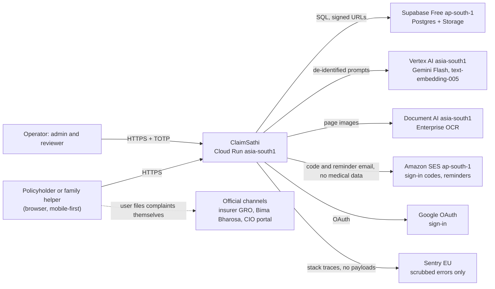
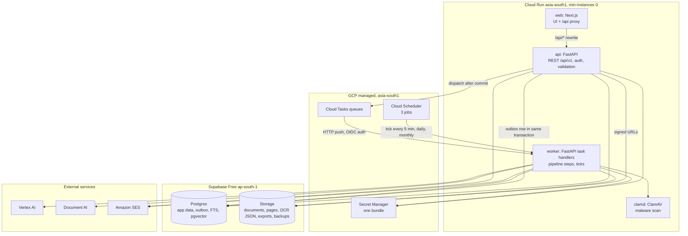
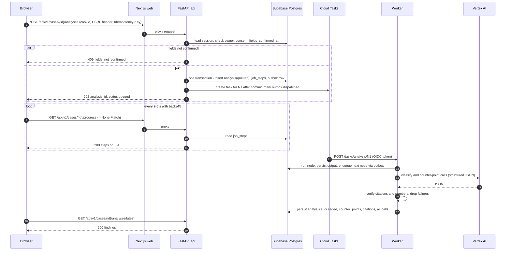
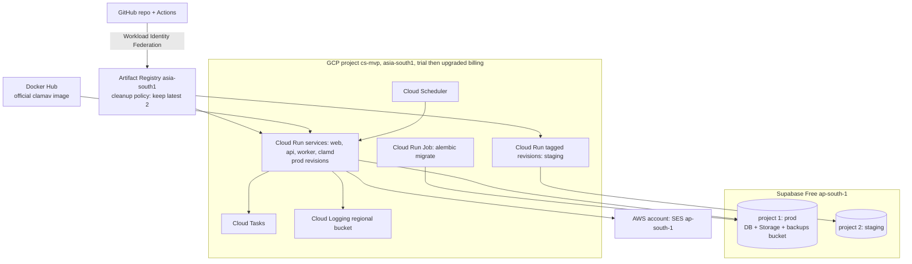
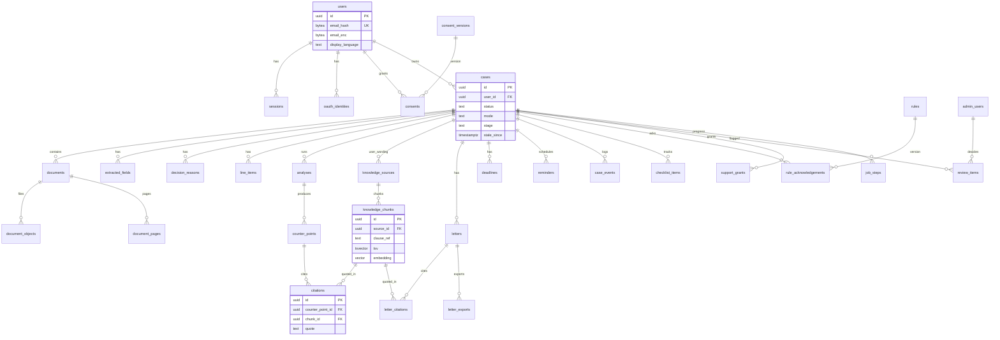
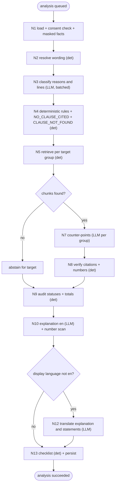

# ClaimSathi: System Architecture and AI/GenAI Technical Design

| Field | Value |
|---|---|
| Version | 1.1 (₹0 MVP profile) |
| Date | 15 October 2026 |
| Supersedes | v1.0 of 15 October 2026 (paid GCP stack with Cloud SQL, a load balancer and phone OTP) |
| Inputs | `docs/01-discovery/competitor-research.md` · `docs/02-product/PRD.md` (scope source of truth) · `docs/02-product/design-system.md` (UI source of truth) |
| Status | **Proposed.** Section 0.3 and §C.11 list the decisions that need product-owner sign-off. §0.4 records the vendor research behind them. |

### Product-owner constraints applied (15 October 2026)

| ID | Constraint |
|---|---|
| D-005 | **₹0 to run the MVP.** Use free tiers and new-account trial credits, and accept their limits. |
| D-006 | **Sign-in with Google, plus an emailed code.** No phone OTP in the MVP, because SMS and TRAI DLT registration cost money. |
| D-007 | **Keep personal and health data in India.** |
| D-008 | **AI runs on a paid, no-training API funded by trial credits.** Free AI tiers are never used with real documents. |

### Labels used in this document

| Label | Meaning |
|---|---|
| **[MVP]** | Required for the MVP |
| **[P1]** | MVP fast-follow |
| **[Scale-up]** | Deferred until free limits are outgrown (§C.12) |
| **VERIFIED** | Read on the vendor's official page on 15 October 2026 |
| **ESTIMATE** | My own calculation |
| **UNVERIFIED** | Could not be confirmed |

---

## 0. Executive summary

### 0.1 Architecture in one paragraph

ClaimSathi is a **modular monolith**. It has three parts:

| Part | What it is |
|---|---|
| Web app | A **Next.js** (TypeScript) web app. It also proxies `/api/*` to the API, so the browser sees a single origin. |
| API | One **FastAPI** (Python) service. |
| Worker | One **worker** service built from the same Python image, driven by **Cloud Tasks** and **Cloud Scheduler**. |

Where the parts run:

- **Compute:** **Google Cloud Run in Mumbai (asia-south1)**, scaled to zero. Cloud Run's always-free allowance applies in this region.
- **Data:** **Supabase Free in Mumbai (ap-south-1)** provides PostgreSQL with pgvector and full-text search, plus object storage for documents.
- **AI and OCR:** **Vertex AI Gemini** and **Document AI**, both in asia-south1, paid from the **$300, 90-day Google Cloud trial credit**.
- **Email:** sign-in codes and reminders go through **Amazon SES in Mumbai**, covered by AWS free-plan credits for 6 months.

The AI pipeline design:

- It is a fixed, code-orchestrated sequence.
- Deadlines, Rule 14 checks, the "no clause cited" check, citation verification and the amounts in letters are all deterministic code.
- The model only extracts, classifies and drafts.

### 0.2 What "₹0" covers, and what it doesn't

| Cost | Status | Basis |
|---|---|---|
| Hosting: web, API, worker, ClamAV | **₹0 within Cloud Run free tier** | 180,000 vCPU-s, 360,000 GiB-s and 2M requests per month on request-based billing. asia-south1 is a Tier 1 region. Idle instances are not charged at min-instances 0. (VERIFIED) |
| Database and file storage | **₹0 within Supabase Free** | 500 MB DB, 1 GB storage, 5 GB egress, 2 active projects (VERIFIED). **The Free plan allowing Mumbai is UNVERIFIED** and must be checked in the project dialog (UD-12). |
| Queue and scheduling | **₹0** | Cloud Tasks: 1M operations per month. Cloud Scheduler: 3 jobs per month. (VERIFIED) |
| Secrets, logs, CI | **₹0** | Secret Manager: 6 active versions, so we use one bundled secret. Cloud Logging: 50 GiB. Artifact Registry: 0.5 GB. (VERIFIED) GitHub Actions minutes for private repositories are UNVERIFIED. |
| OCR | **₹0 for the first 1,000 pages** | Document AI Enterprise OCR pricing table. Whether the 1,000 pages are per month is UNVERIFIED. After that, $1.50 per 1,000 pages from credits. |
| AI calls (Gemini, embeddings) | **₹0 only while the $300 trial credit lasts (90 days at most)** | Vertex AI has no free token tier (VERIFIED). Trial credits "can't pay for Gemini API in AI Studio" or partner models (VERIFIED). Google's own Vertex models are not listed as excluded; inclusion is not stated (UNVERIFIED). |
| Email (codes and reminders) | **₹0 for 6 months** on AWS free-plan credits | SES has no permanent free allowance. "Up to $200" credits, and the free plan lasts 6 months. Then $0.10 per 1,000 emails. (VERIFIED) |
| Custom domain | **Not ₹0.** The MVP uses the free `*.run.app` URL. | A domain (about ₹700–1,000 a year, ESTIMATE) is recommended before public launch (UD-11). |

**Bottom line.** Hosting stays at ₹0 indefinitely while usage is within the free tiers. The **AI cost is ₹0 only during the trial**. After the trial, each case costs about **₹7–10** with Gemini 2.5 Flash (ESTIMATE, §1.4).

**No India-resident, no-training, free AI exists** (VERIFIED). The Gemini Developer API free tier says "Do not submit sensitive, confidential, or personal information to the Unpaid Services". Vertex express mode uses a global endpoint.

**Time the trial to the beta.** The trial is 90 days. Build stages 0–4 locally and on free tiers *before* activating it (§C.10).

### 0.3 Decisions needing product-owner sign-off

| ID | Decision | Blocks |
|---|---|---|
| UD-01 | MVP model: **Gemini 2.5 Flash** (cheapest India-resident option, to stretch credits), with **Gemini 3.5 Flash** if the bake-off shows 2.5 misses thresholds. Claude is **dropped from the bake-off** because trial credits cannot pay for it. | Consent copy (names the provider); AI build |
| UD-02 | AI-002 exception for the extraction call (names are visible to the model; processing stays in India) | AI-002 compliance |
| UD-03 | Stack: GCP Cloud Run + Supabase Free (Mumbai) + Amazon SES (Mumbai) | Setup |
| UD-04 | What happens when credits run out: upgrade billing and pay per case (about ₹7–10), or pause AI features | Beta timeline |
| UD-05 | Custom authentication (Google + email code) rather than Supabase Auth | Auth build |
| UD-11 | `*.run.app` URL for the closed beta; buy a domain before public launch | Trust and branding |
| UD-12 | **Confirm Supabase Free can create a project in Mumbai.** If it can't, the fallback is Cloud SQL paid from credits (90 days), then a decision. | Database |

### 0.4 Key verified facts (vendor research, 15 October 2026)

**AI and OCR**

| Fact | Source |
|---|---|
| Gemini 3.5 Flash and 2.5 Flash (128k) have in-India ML processing in asia-south1. Prices: 3.5 Flash $1.65 / $9.90 and 2.5 Flash $0.30 / $2.50 per 1M input/output tokens. | Vertex AI data-residency and pricing pages |
| The Gemini Developer API free tier is "used to improve our products: Yes". Its terms say not to submit personal information. The paid tier does not train on data. | ai.google.dev pricing and terms |
| Claude cannot be processed in India. Anthropic's `inference_geo` is `global` or `us` only. Bedrock serves Claude 5.5 from Mumbai via global cross-region inference. Vertex runs Claude in Singapore. | Anthropic, AWS and Google docs |
| Document AI Enterprise OCR covers Gujarati and Hindi, is in asia-south1 with "limited support", gives the first 1,000 pages free, then $1.50 per 1,000. Azure Read does not extract Gujarati. Textract has no Indic support. | Google, Microsoft and AWS docs |

**Google Cloud free tier and trial**

| Fact | Source |
|---|---|
| Cloud Run's free tier is a spending-based discount at Tier 1 pricing, and asia-south1 is Tier 1. Idle non-minimum instances are not charged. | cloud.google.com/run/pricing |
| **Cloud Storage's free tier is US regions only. Mumbai storage is billed.** The Compute Engine e2-micro free VM is US-only too. | Google Cloud Free Program page |
| Cloud SQL has no always-free tier, only a 30-day trial instance. | cloud.google.com/sql/pricing |
| The trial is $300 for 90 days. It auto-closes with no charge unless you upgrade. Resources are deleted 30 days after it closes. | Google Cloud signup FAQ and Free Program page |

**Data, email and authentication**

| Fact | Source |
|---|---|
| Supabase Free pauses a project after a week of low activity ("a few user requests to the database each day" usually prevents this). It has **no backups**. Its default SMTP sends only to team addresses, at 2 per hour. | supabase.com pricing and docs |
| SES has endpoints in ap-south-1. New AWS accounts get up to $200 in free-tier credits; the free plan lasts 6 months; then $0.10 per 1,000 emails. | aws.amazon.com/ses/pricing |
| Firebase Auth runs only from US data centres, and Spark allows 5 email-link sign-ins a day. This rules it out. | firebase.google.com |
| Neon, Render and Railway have no India region. Aiven Free cannot choose its region. Oracle Always Free reclaims VMs whose 95th-percentile CPU, network and memory all stay under 20% for 7 days, which is a risk for a low-traffic MVP. | Vendor docs |

---

# PART A: SYSTEM ARCHITECTURE

## 1. Technology decisions

### 1.1 Decision table

| Layer | Choice | MVP? | Why it fits | Alternatives considered | Trade-offs | Lock-in / migration |
|---|---|---|---|---|---|---|
| Frontend | **Next.js (App Router, TypeScript)**, Tailwind with design tokens, Radix, TipTap, next-intl, TanStack Query, react-hook-form + Zod | MVP | Locale routes and server-side rendering. TipTap supports ProtectedQuote. | Remix; SvelteKit; Vite SPA | Self-hosted, not on Vercel (whose DPA processes data in the US). | Low |
| Frontend hosting + API gateway | **Cloud Run (asia-south1), min-instances 0.** Next.js `rewrites` proxy `/api/*` to the API service, so the browser sees one origin. | MVP | ₹0 at idle. One origin means first-party cookies and no CORS. | HTTPS load balancer (fixed monthly cost; [Scale-up]); separate API domain (CORS) | **Cold starts** on the first request after idle (§5 of the testing strategy). An extra proxy hop. | Low |
| Backend | **Python 3.12 + FastAPI + Pydantic v2 + SQLAlchemy 2 + Alembic** | MVP | Best OCR, PDF and AI tooling. Generates the OpenAPI contract. | Node/NestJS; Django | Two languages | Low |
| Background jobs | **Cloud Tasks (HTTP push) → Cloud Run `worker` service**, with a **transactional outbox** in Postgres. **Cloud Scheduler** triggers the periodic ticks. | MVP | ₹0. There is no always-on worker, which would cost money under min-instances or CPU-always billing. Each pipeline step is one task. | Procrastinate (needs a polling worker that is always on; [Scale-up]); Celery + Redis | Cloud Tasks is not in the database transaction, so the outbox closes that gap (§3.6). | Medium. The `jobs` facade hides it, and a Procrastinate adapter is planned for scale-up. |
| Database | **Supabase Free, Mumbai (ap-south-1)**: Postgres with **pgvector** and full-text search | MVP | The only ₹0 managed Postgres found with an India region (VERIFIED list; Free-plan availability UD-12). | Cloud SQL (no free tier); Neon and Aiven (no India region, or region not selectable); self-hosted on Oracle Always Free (idle-reclamation risk) | 500 MB cap. **No backups** (we run our own, §4.8). Pauses after 7 low-activity days; the 5-minute scheduler tick queries the DB. | Low. Standard Postgres; `pg_dump` portable. |
| Object storage | **Supabase Storage (Mumbai)**: private buckets, signed URLs, **TUS resumable uploads**, 50 MB max upload | MVP | ₹0 within 1 GB. Stays in India. Same project as the DB. | GCS Mumbai (billed from the first byte, VERIFIED) | **1 GB total.** Per-case caps are lowered (§4.5); there is no soft delete. | Low. Behind the `ObjectStore` adapter; S3-compatible API. |
| Authentication | **Custom: Google OAuth (Authlib) + 6-digit email code**, server sessions in Postgres, HttpOnly cookies. Admin: Google allowlist + TOTP. | MVP | ₹0 (Google OAuth is free). Identity data stays in the Mumbai DB. Phone OTP is [Scale-up] (D-006). | Supabase Auth (works, but browser-held tokens and its own SMTP rules); Firebase Auth (US-only, 5 email links a day) | We own security-critical code. Scope is small: no passwords. | Low |
| Email | **Amazon SES, ap-south-1** (API) | MVP | India region. ₹0 for 6 months on credits, then about ₹0.01 per email. | Brevo free (EU, UNVERIFIED limits); Resend free (US data, 100 a day); Gmail SMTP (personal-account terms, deliverability) | Not permanently ₹0. Volume is kept low: codes plus at most 5 reminders per case. | Low. `Mailer` adapter. |
| LLM | **Gemini 2.5 Flash on Vertex AI, asia-south1**, upgrading to **Gemini 3.5 Flash** only if the bake-off requires it | MVP | In-India processing (VERIFIED), structured output, no training, lowest in-India price (VERIFIED). | Claude (not India-resident; trial cannot pay; quality reference dropped); Gemini free tier (trains on data, so rejected) | Credits run out in 90 days at most. Thinking-token billing must be measured. | Medium. `ModelGateway`. |
| Embeddings | **text-embedding-005 (Vertex, asia-south1)** over the English corpus | MVP | In-India processing. Negligible credit use. | gemini-embedding-001 (no India guarantee); bge-m3 self-hosted (needs memory and a large image) | — | Low |
| OCR | **Document AI Enterprise OCR (asia-south1)**; Tesseract only for local development | MVP | Gujarati and Hindi supported; 1,000 pages free; line bounding boxes. | Cloud Vision (1,000 units a month free, but the endpoint is not region-pinned); Sarvam (paid) | "Limited support" region. Tesseract is left out of production images to save Artifact Registry space. | Low |
| PDF/DOCX | **WeasyPrint + python-docx** with embedded Noto fonts | MVP | Indic shaping (HarfBuzz) | Headless Chromium | Image size (keep under the 0.5 GB registry budget) | Low |
| Malware scan | **ClamAV**, using the official image pulled from Docker Hub, on Cloud Run with min-instances 0 | MVP | ₹0 within the free tier, and the image does not use Artifact Registry space. Cloud Run accepting Docker Hub images is UNVERIFIED; the fallback is mirroring to Artifact Registry and accepting about ₹10 a month if over 0.5 GB. | Cloud scanning APIs (paid) | Cold start about 30–60 s while signatures load (ESTIMATE). Acceptable because the scan is asynchronous. | Low |
| Secrets | **Secret Manager, one JSON bundle secret per environment.** The field-encryption key lives in the bundle; **no Cloud KMS** in the MVP. | MVP | Stays within the 6 free versions. KMS is billed per key. | KMS envelope encryption ([Scale-up]) | Weaker key isolation than KMS. Key rotation means a new bundle version. | Low |
| Monitoring | **Cloud Logging** (50 GiB free; logs routed to a regional asia-south1 bucket), **Cloud Monitoring** basic alerts, **Sentry free plan (EU)** with strict scrubbing, and an `ai_calls` table | MVP | ₹0 | Grafana Cloud India (paid tiers) | Sentry is outside India, so scrubbing is mandatory. | Low |
| Infrastructure as code / CI | **Terraform** (state in Supabase Storage or locally) + **GitHub Actions** with Workload Identity Federation | MVP | ₹0 | Cloud Build (2,500 free minutes) | — | Low |

### 1.2 Not used in the MVP

| Component | Status | Reason |
|---|---|---|
| Cloud SQL | [Scale-up] | No free tier |
| GCS | [Scale-up] | Mumbai storage is billed |
| HTTPS load balancer and Cloud Armor | [Scale-up] | Fixed monthly cost |
| Cloud KMS | [Scale-up] | Billed per key |
| Procrastinate always-on worker | [Scale-up] | Needs an always-on instance |
| Phone OTP (MSG91 + DLT) | [Scale-up] | D-006 |
| Redis | Not used | — |
| Separate vector DB | Not used | — |
| Reranker | Not used | — |
| Agent frameworks | Not used | §9 |
| Row-Level Security | **[P1]** before public launch | Free on Supabase |

### 1.3 Environments

| Environment | Where | Data |
|---|---|---|
| `local` | Docker Compose: Postgres + pgvector, a MinIO or Supabase-local storage emulator, clamd, Mailpit, and the fake model and OCR adapters (Tesseract optional) | Synthetic only. **Use this for stages 0–4, before the trial starts.** |
| `staging` | **Supabase Free project #2 (Mumbai)**, plus Cloud Run revisions tagged `staging` in the same GCP project | Synthetic, plus consented research cases (§9 of the evaluation plan) |
| `prod` | **Supabase Free project #1 (Mumbai)**, plus Cloud Run (asia-south1) | Real data |

**Constraints this creates:**

- Supabase Free allows only 2 active projects, so this uses the full allowance.
- Cloud Run's free tier is per billing account, so staging and prod share it.

### 1.4 Cost model

**Fixed monthly cost, MVP: ₹0** within the free tiers in §0.2.

Watch these limits:

| Limit | Threshold |
|---|---|
| Cloud Run usage | Above 180k vCPU-s or 360k GiB-s per month |
| Supabase DB | Above 400 MB (alert at 80%) |
| Supabase Storage | Above 800 MB (alert at 80%) |
| Artifact Registry | Above 0.5 GB |
| Document AI | Above 1,000 pages |

**Variable cost per completed case** (to Stage 1 export). Unit prices are VERIFIED; token counts are ESTIMATES.

| Step | Tokens / pages | Gemini 2.5 Flash ($0.30 / $2.50 per 1M) | Gemini 3.5 Flash ($1.65 / $9.90) |
|---|---|---|---|
| OCR, 30 pages (after the free 1,000) | 30 pages × $1.50 / 1,000 | 0.045 | 0.045 |
| Extraction (2 calls) | 20k / 3k | 0.0135 | 0.063 |
| Classification | 3k / 0.5k | 0.002 | 0.010 |
| Counter-points, 6 groups | 6 × (8k / 1.5k) | 0.037 | 0.168 |
| Explanation + translation | 4k / 2.5k | 0.0075 | 0.031 |
| Letter + translation | 10k / 5k | 0.0155 | 0.066 |
| **Total per case** | | **≈ $0.12 (≈ ₹10)** | **≈ $0.38 (≈ ₹33)** |

These totals assume ₹88 per US$. They exclude thinking tokens and retries. With OCR inside the free 1,000 pages, the 2.5 Flash cost is about ₹7.

**Trial credit budget ($300; PROVISIONAL split)**

| Use | Budget | Notes |
|---|---|---|
| Bake-off and evaluation | ≤ $100 | Test split of about 60 cases × 3 runs × 2 models ≈ 360 runs. Measure and stop early if the budget is reached. |
| Development and staging | ≤ $50 | — |
| Closed beta | ≥ $150 | About 1,200 cases at the 2.5 Flash ESTIMATE. A beta of about 30 cases (PRD §10.3) uses a small fraction. |

**Budget alerts** fire at 25%, 50%, 75% and 90% of the credit, from GCP budget alerts plus an application check on `ai_calls`. At 90%, new analyses are paused and the admin is alerted (PRD NFR-023).

---

## 2. Architecture diagrams

### 2.1 System context



### 2.2 Containers and services



### 2.3 Main data flows

```mermaid
flowchart LR
  A["Browser uploads file<br/>TUS resumable to Supabase Storage"] --> B[("Storage uploads/")]
  B --> C["task scan: ClamAV + magic bytes"]
  C -->|"clean"| D["task render: pages to PNG"]
  C -->|"infected or spoofed"| X["delete object, mark rejected"]
  D --> E["task OCR: Document AI"]
  E --> F[("Storage ocr json<br/>lines + bounding boxes")]
  F --> G["task extract: Gemini<br/>structured fields + line items"]
  G --> H[("Postgres extracted_fields, line_items")]
  H --> I{"User confirms facts"}
  I --> J["analysis tasks N1..N13"]
  J --> K["deterministic rules + audit"]
  J --> L["hybrid retrieval<br/>FTS + pgvector"]
  L --> M["Gemini counter-points<br/>JSON with chunk_id + quote"]
  M --> N["citation and number verifier"]
  K --> O[("analyses, counter_points, citations")]
  N --> O
  O --> P["letter tasks: skeleton + grounds + translation + verify"]
  P --> Q[("letters")]
  Q --> R["export task: WeasyPrint / python-docx"]
  R --> S[("Storage export, signed link 24h")]
```



### 2.4 Core request lifecycle: generating findings



### 2.5 Deployment topology



---

## 3. Backend design

### 3.1 Module map (one Python package, `claimsathi`)

| Module | Responsibility | PRD |
|---|---|---|
| `api` | Routers, schemas, dependencies (session, CSRF, case access, rate limit, idempotency) | All |
| `tasks_api` | **Worker HTTP endpoints** for Cloud Tasks and Scheduler (`/tasks/*`, `/ticks/*`). Accepts only Google-signed OIDC tokens from the task service account. | — |
| `auth` | Email codes, sessions, Google OAuth, admin TOTP | FR-001–003, FR-037 |
| `users` | Profile, settings, email change, account deletion | FR-036, FR-032 |
| `consent` | Versions, grant/withdraw, enforcement guard | FR-005 |
| `cases` | Lifecycle, eligibility, open-case limit, staleness, close/outcome | FR-006, FR-007, FR-034 |
| `documents` | Upload sessions (TUS), PDF unlock, grouping, status machine, magic-byte check | FR-008, FR-009 |
| `ocr` | `OcrEngine` (Document AI; Tesseract for local), page render, quality | FR-010 |
| `extraction` | Fields and line items, confirmation gate | FR-010–012 |
| `knowledge` | Sources, chunking, embeddings, versioning, case wordings | FR-014, FR-038 |
| `retrieval` | Hybrid search, filters, context assembly | AI-004 |
| `rules` | Versioned rules, RULE-ESC and RULE-MC evaluators, deadline math | FR-016, FR-020, FR-021, FR-039 |
| `analysis` | Node orchestration (N1–N13), audit statuses, counter-points, explanation, checklist | FR-013–019 |
| `verify` | Citation verifier, number scanner, banned phrases | AI-004, AI-005, FR-017 |
| `ai` | `ModelGateway` (Vertex), prompts, schema validation, retries, cost accounting, PII masker, credit-budget guard | AI-001–015 |
| `letters` | Skeleton, grounds, translation, editor persistence, review | FR-024–027 |
| `exports` | PDF/DOCX, data-export ZIP | FR-028, FR-030 |
| `escalation` | Stages, Ombudsman checks, events, packs, **.ics calendar export** | FR-020, FR-023, FR-025, FR-026, FR-022 |
| `notifications` | Reminders (email + in-app) | FR-022 |
| `reviews` | Reports, verifier rejections, audit sampling, support grants | FR-035, FR-040, FR-042 |
| `admin` | Knowledge sources, rules, metrics | FR-037–041 |
| `analytics` | Whitelisted events | PRD §7 |
| `storage` | `ObjectStore` (Supabase Storage via S3-compatible API; MinIO locally), signed URLs, prefix deletion | — |
| `jobs` | **Outbox + Cloud Tasks dispatcher**, task registry, step tracking, tick handlers | — |
| `security` | Field encryption (key from the secret bundle), HMAC hashing, CSRF, scanner client | NFR-004–006 |
| `backup` | Nightly encrypted logical backup (§4.8) | NFR-007 |
| `audit`, `ratelimit`, `i18n`, `core` | Audit log (no content), Postgres rate limiter, backend strings for letters and emails, config/DB/errors/logging/clock | — |

### 3.2 Layering rules


```
routers → services (transactions; write outbox rows) → repositories (owner-scoped SQL) → Postgres
                  └→ adapters (ObjectStore, OcrEngine, ModelGateway, Embedder, Mailer, MalwareScanner, TaskQueue)
```

1. **Routers** validate input with Pydantic, resolve dependencies and call **one service method**. They contain no SQL and no business rules.
2. **Services** own transactions (`async with uow:`). They write `outbox` rows inside the same transaction, never calling Cloud Tasks mid-transaction.
3. **Repositories** take an explicit `owner_user_id` for every case-scoped query. Admin repositories live in `admin` and take an `AdminActor`.
4. **Adapters** implement Protocols, and tests use fakes.
5. **Domain values:** money is an integer number of paise. Dates are `date` in IST. Timestamps are UTC `timestamptz`.

### 3.3 API routing and validation

- Base path `/api/v1`, reached through the Next.js rewrite to the API's Cloud Run URL.
- Pydantic v2 with `extra="forbid"`.
- `openapi.json` is generated and committed.
- **Worker endpoints are not exposed through the web proxy.** They live on the worker service URL with **Cloud Run IAM "require authentication"**, and only the Cloud Tasks and Scheduler service account holds the invoker role.

### 3.4 Authentication and authorization


**Consumer sign-in (D-006)**

1. **Google:**
   - Authlib OIDC with PKCE; `state` and the nonce are held in a signed cookie that lives 10 minutes.
   - The callback upserts `oauth_identities(provider='google', subject=sub)`.
   - It sets `users.email_hash` and `email_enc` from the verified `email` claim (`email_verified=true` required).
2. **Email code request** (`POST /auth/email/request`):
   - Normalise the email (trim, lowercase).
   - Compute `email_hash = HMAC-SHA256(HASH_PEPPER, email)`.
   - Enforce the limits: 5 per hour per email, 20 per hour per IP hash, and a global daily cap.
   - Create an `email_challenges` row with `code_hash = HMAC(CODE_PEPPER, challenge_id‖code)` and a 10-minute expiry.
   - Send the localised code email through SES. It contains **only** the code and the expiry.
3. **Email code verify** (`POST /auth/email/verify`):
   - Constant-time compare; `attempts += 1`; the challenge is invalidated at 5 attempts.
   - On success, upsert the user and create a session.
4. **Session:** a 256-bit random token with only its SHA-256 stored. It is set in the cookie `cs_session` (HttpOnly, Secure, SameSite=Lax, Path=/). Idle expiry is 24 hours, or 30 days if `trusted`. Absolute expiry is 90 days (PROVISIONAL).
5. **CSRF:** double-submit. The `cs_csrf` cookie must equal the `X-CSRF-Token` header on unsafe methods, and the `Origin` header must equal `PUBLIC_BASE_URL`.
6. **Sign out everywhere:** sets `revoked_at` on all of the user's sessions. The check runs on every request, so it is immediate.
7. **Account linking:** Google and email-code sign-ins with the **same verified email** resolve to one user. Both prove control of that email.

**Admin**

- Google sign-in against `admin_users` (an allowlist seeded from `ADMIN_BOOTSTRAP_EMAIL`).
- **Mandatory TOTP** (pyotp) on every sign-in. After 5 failed TOTP attempts in 15 minutes, the account is locked for 15 minutes.
- Session kind `admin`, cookie `cs_admin`, 8-hour absolute expiry.

**Authorization**

| Check | Mechanism |
|---|---|
| User owns the case | `CaseAccess` dependency: `WHERE id=:id AND user_id=:uid AND deleted_at IS NULL`. A miss returns **404, never 403**. |
| Consent is current | `ConsentGuard` on case-creating and processing endpoints **and at the start of every task handler**. A miss returns 403 `consent_required`, or the task aborts. |
| Preconditions | Service checks: facts confirmed, not stale, no failing Block rule, letter version reviewed, credit guard open. A miss returns 409 or 503 with a specific code. |
| Admin role | `RequireAdmin(role)`; `reviewer` can use only the review endpoints. |
| Reviewer access to case content | Requires an active `support_grants` row; every access is audited. Otherwise 403 `support_access_not_granted`. |
| Worker endpoints | Cloud Run IAM ("require authentication"). The handler also verifies the OIDC audience and the service-account email. |
| Defence in depth [P1] | Postgres RLS on case-scoped tables using `current_setting('app.user_id')`, set per transaction. The worker uses a separate role. |

**Supabase hardening.** We do not use Supabase's auto-generated Data API (PostgREST) or Supabase Auth.

- The Data API is **disabled** for both projects. If it cannot be disabled, RLS is enabled with **no policies** (deny-all) on every table.
- The `anon` and `service_role` keys are never shipped to the browser.
- Storage buckets are private.

### 3.5 Business logic state machines


**Document status**

```
uploading → queued → scanning → reading → ready
                 ↘ rejected (malware, spoofed type, duplicate, unsupported)
reading → needs_attention (quality < threshold)
any step → failed (retries exhausted)
```

**Case stage** (PRD FR-020):

- `S0_PREPARE` → `S1_INSURER_GRIEVANCE`, on the `s1_sent` event.
- `S1_INSURER_GRIEVANCE` → `S3_OMBUDSMAN`, on the `s3_filed` event, and only if no Block rule fails at that time.
- `S2_BIMA_BHAROSA` is a **parallel flag** (`s2_filed_at`), not a stage on the main path.
- Any stage → `CLOSED`.

**Staleness.** Changing confirmed facts, line items, the wording source or the current decision sets `cases.stale_since = now()`. An analysis or letter created before `stale_since` is stale. Exports and generation then return 409 `case_stale`.

**Open-case limit.** The create transaction runs `SELECT … FOR UPDATE` on the user row, counts open cases, and rejects the 11th.

**Analysis status:** `queued` → `running` → `succeeded` | `failed` | `superseded` | `paused_budget`.

### 3.6 Background jobs: outbox + Cloud Tasks + Scheduler


**Outbox pattern**

1. A service inserts an `outbox` row in the **same transaction** as the state change. The row holds `task_name`, `queue`, `payload` (IDs only), `dedupe_key` and `not_before`.
2. After commit, the API attempts an immediate dispatch with `CreateTask`, using a task **name** derived from `dedupe_key` so that Cloud Tasks rejects duplicates. On success the row is marked `dispatched`.
3. The `tick-5min` handler re-dispatches rows still `pending` after 2 minutes. This guarantees delivery if the instance dies after commit.

**Task handlers** (`POST /tasks/{task_name}` on the worker)

- Every handler is idempotent and keyed by `(job_ref, step_key)` in `job_steps`.
- It checks consent, the case and the credit guard; skips the step if it is already `done`; runs it; persists the output; writes the next step's outbox row; then returns 2xx.
- A non-2xx response makes Cloud Tasks retry, according to the queue policy.

**Queues** (Cloud Tasks, asia-south1)

| Queue | Max concurrent dispatches | Max attempts | Backoff | Used for |
|---|---|---|---|---|
| `docs` | 5 | 4 | 10 s → 300 s | scan, render, OCR, extract |
| `ai` | 4 | 4 | 30 s → 900 s | analysis and letter nodes |
| `io` | 5 | 5 | 30 s → 3,600 s | email, exports, purge, backup trigger |

The dispatch deadline is 10 minutes, and every step is designed to finish in 5 minutes or less.

**Tasks**

| Task | Trigger | Timeout | Idempotency |
|---|---|---|---|
| `doc.scan` | Upload completed | 120 s | `document_id`; no-op if past `scanning` |
| `doc.render_pages` | Clean scan | 180 s | Overwrites the same keys |
| `doc.ocr` | After render | 300 s | Same |
| `doc.extract` | All case documents ready | 180 s | Replaces `(case_id, extraction_run_id)` |
| `analysis.node` (N1–N13) | `POST /analyses`, then chained | 300 s per node | `(analysis_id, node, target_id)` |
| `letter.node` (L1–L7) | `POST /letters`, then chained | 300 s per node | `(letter_id, node)` |
| `export.render` | `POST /letters/{id}/exports` | 120 s | `(letter_id, version, format)` |
| `export.data_zip` | `POST /exports` | 300 s | `export_id` |
| `case.purge` | Case or account delete | 300 s | Re-runnable; deleting an absent object is OK |
| `notify.send` | Due reminder or sign-in code | 30 s | Unique `(case_id, kind, channel, send_at)`; status checked before sending |

**Scheduler jobs** (exactly 3, the free allowance)

| Job | Schedule (IST) | Handler |
|---|---|---|
| `tick-5min` | Every 5 min | Re-dispatches the outbox; enqueues due reminders (`FOR UPDATE SKIP LOCKED`); housekeeping (expired codes, sessions, idempotency keys, rate buckets, stale uploads). **The DB queries keep the Supabase project active.** |
| `daily-0200` | 02:00 daily | Retention purges; inactive-case notices; **encrypted backup job** (§4.8); quota snapshot and alerts; credit-spend check |
| `monthly-audit` | 03:00 on the 1st | Creates 100 audit `review_items` (FR-040) |

**Progress.** `job_steps` rows are written at each transition and feed the design system's ProcessingSteps. They show real steps only.

**Stop conditions:**

- consent withdrawn or case deleted (checked first);
- superseded by a newer analysis;
- more than 2 hours since the job started;
- the credit guard is tripped (`paused_budget`).

### 3.7 Error handling and retries


**Error format.** RFC 9457 `application/problem+json`:

```json
{ "type": "https://claimsathi.example/errors/fields_not_confirmed", "title": "Details not confirmed",
  "status": 409, "code": "fields_not_confirmed", "detail": "Confirm your case details before analysis.",
  "request_id": "01J…", "errors": [ { "field": "decision_letter_date", "code": "required", "message": "…" } ] }
```

The UI localises messages from `code`.

**Error-code catalogue**

| Code | HTTP | When |
|---|---|---|
| `validation_error` | 422 | Schema or field validation failed |
| `not_found` | 404 | Missing **or not owned** |
| `unauthenticated` | 401 | No session, or session expired |
| `consent_required` | 403 | Consent missing or outdated |
| `forbidden` / `support_access_not_granted` | 403 | Role or grant missing |
| `csrf_failed` | 403 | Token or Origin mismatch |
| `rate_limited` | 429 + `Retry-After` | Rate limits (§5.5) |
| `email_code_invalid` | 401 + `attempts_left` | Wrong code |
| `email_code_expired` | 410 | Code expired |
| `fields_not_confirmed` / `line_items_not_confirmed` | 409 | FR-011 / FR-012 gate |
| `case_stale` | 409 | Staleness |
| `rule_blocked` | 409 + `failing_rules[]` | FR-020 Block |
| `warnings_not_acknowledged` | 409 | FR-020 Warn |
| `letter_not_reviewed` | 409 | AI-007 |
| `version_conflict` | 409 + `current_version` | Optimistic concurrency |
| `idempotency_key_reused` | 409 | Same key, different body |
| `open_case_limit` | 409 | FR-007 |
| `duplicate_file` | 409 | FR-008 |
| `case_upload_limit` | 409 | 15 files, 50 MB or 60 pages exceeded |
| `payload_too_large` / `unsupported_media_type` | 413 / 415 | FR-008, including the magic-byte mismatch |
| `pdf_password_required` / `pdf_password_incorrect` | 422 | FR-008 |
| `out_of_scope` | 422 | FR-006 guard |
| `ai_paused_budget` | 503 | Credit guard tripped |
| `internal_error` | 500 | Unhandled; Sentry event plus `request_id` |

**Retries**

- Retries happen only in task handlers and adapters.
- Retryable: network errors, 429, 5xx. Not retryable: 4xx, and schema-invalid model output after the one repair attempt.
- **Circuit breaker** per provider, stored in `breaker_state` because instances scale to zero. 5 consecutive failures open it for 60 seconds. While it is open, steps go to `retrying` and are re-enqueued with a delay. PRD AI-008: auto-retry in 15 minutes, give up after 2 hours.

### 3.8 Logging and observability


**Logs**

- structlog JSON to stdout, which goes to Cloud Logging.
- A log router sends production logs to a **regional bucket in asia-south1**, with 30-day retention (PROVISIONAL).
- **Allowed fields:** `request_id`, `route`, `status`, `latency_ms`, `user_pseudo_id` (HMAC), `case_id`, `job`, `step`, `error_code`, `cold_start` (bool).
- **Never logged:** bodies, OCR text, field values, emails, names, document content, prompts, model outputs, PDF passwords, sign-in codes.
- An allowlist processor and a unit test enforce this.

**Sentry** (free plan, EU):

- `send_default_pii=False`.
- `before_send` strips request data, cookies, headers (except User-Agent), local variables and breadcrumb messages.

**Metrics.** Log-based metrics and Cloud Monitoring alerts per PRD NFR-020, plus:

- cold-start latency;
- the daily `quota_snapshots` metrics: DB MB, storage MB, Document AI pages, credit spend, registry MB.

### 3.9 External integrations

| Integration | Adapter | Auth | Notes |
|---|---|---|---|
| Vertex AI Gemini and embeddings | `ModelGateway.vertex`, `Embedder.vertex` (google-genai SDK, `location=asia-south1`) | Runtime service account | Disable durable caching. Request the abuse-logging exception. |
| Document AI | `OcrEngine.docai` | same | Synchronous for ≤15 pages |
| Supabase Postgres | SQLAlchemy over the **Supavisor pooler** (transaction mode) | DB password in the secret bundle | Connection caps on Free: keep the pool ≤ 5 per instance |
| Supabase Storage | `ObjectStore.supabase` (S3-compatible endpoint for server operations; TUS endpoint for browser uploads through a short-lived signed upload token issued by our API) | S3 access keys / service key in the bundle, **server-side only** | 50 MB max per object |
| Cloud Tasks / Scheduler | `TaskQueue.cloudtasks` | Runtime service account; OIDC to the worker | — |
| Amazon SES | `Mailer.ses` (API, ap-south-1) | IAM keys in the bundle | Bounce handling is [P1] |
| Google OAuth | Authlib | Client ID and secret in the bundle | Separate consumer and admin clients |
| ClamAV | `MalwareScanner.clamd` (TCP to the clamd service) | Cloud Run IAM | Fails closed |

---

## 4. Database and storage design

### 4.1 Entity-relationship diagram (core)



### 4.2 Table definitions


**Conventions**

- `id uuid PK DEFAULT gen_random_uuid()`.
- `created_at` and `updated_at timestamptz NOT NULL DEFAULT now()`.
- Case-scoped tables have `case_id uuid NOT NULL REFERENCES cases(id) ON DELETE CASCADE` plus an index on it.
- `*_enc` columns are AES-256-GCM ciphertext (§4.6).
- Money is `bigint` paise with `CHECK (>= 0)`.

#### Identity and consent

| Table | Columns | Indexes |
|---|---|---|
| `users` | `email_hash bytea UNIQUE NOT NULL`, `email_enc bytea NOT NULL`, `email_verified_at timestamptz NOT NULL`, `phone_hash bytea UNIQUE NULL` + `phone_enc bytea NULL` ([Scale-up] phone sign-in), `display_language text NOT NULL DEFAULT 'en' CHECK (display_language IN ('en','gu','hi'))`, `large_text bool NOT NULL DEFAULT false`, `analytics_opt_out bool NOT NULL DEFAULT false`, `onboarded_at timestamptz` | unique on the hashes |
| `oauth_identities` | `user_id FK→users ON DELETE CASCADE`, `provider text CHECK (provider='google')`, `subject text NOT NULL`, `UNIQUE(provider, subject)` | (user_id) |
| `email_challenges` | `email_hash bytea NOT NULL`, `code_hash bytea NOT NULL`, `purpose text CHECK (purpose IN ('sign_in','change_email'))`, `user_id uuid NULL` (for change_email), `expires_at timestamptz NOT NULL`, `attempts smallint NOT NULL DEFAULT 0 CHECK (attempts <= 5)`, `consumed_at timestamptz`, `ip_hash bytea` | (email_hash, created_at DESC) |
| `sessions` | `token_hash bytea UNIQUE NOT NULL`, `kind text CHECK (kind IN ('user','admin'))`, `user_id FK ON DELETE CASCADE NULL`, `admin_user_id FK→admin_users NULL`, `trusted bool`, `idle_expires_at`, `absolute_expires_at`, `last_seen_at`, `revoked_at`, `CHECK ((kind='user') = (user_id IS NOT NULL))` | (user_id) WHERE revoked_at IS NULL |
| `admin_users` | `google_sub text UNIQUE`, `email text UNIQUE NOT NULL`, `role text CHECK (role IN ('admin','reviewer'))`, `totp_secret_enc bytea`, `totp_enabled_at`, `failed_totp smallint`, `locked_until timestamptz`, `disabled_at` | — |
| `consent_versions` | `version text PK`, `purposes jsonb NOT NULL`, `notice_sha256 bytea NOT NULL`, `published_at`, `requires_reconsent bool NOT NULL` | — |
| `consents` | `user_id FK ON DELETE CASCADE`, `version FK`, `purposes text[] NOT NULL` (subset of `processing`, `reminders`), `language`, `granted_at`, `withdrawn_at`, `ip_hash` | (user_id, granted_at DESC) |

#### Cases and documents

| Table | Columns | Indexes |
|---|---|---|
| `insurers` | `id smallint PK`, `name text UNIQUE`, `aliases text[]`, `active bool` | GIN(aliases) |
| `cases` | `user_id FK ON DELETE CASCADE`, `nickname_enc bytea NOT NULL`, `status CHECK (status IN ('open','closed'))`, `mode CHECK (mode IN ('full','limited','delay'))`, `stage CHECK (stage IN ('S0_PREPARE','S1_INSURER_GRIEVANCE','S3_OMBUDSMAN','CLOSED'))`, `s2_filed_at`, `insurer_id FK NULL`, `policy_type CHECK (policy_type IN ('individual','floater','group','unknown'))`, `complainant_name_enc`, `complainant_relation`, `patient_name_enc`, `eligibility jsonb NOT NULL`, `current_decision_document_id uuid NULL FK→documents DEFERRABLE INITIALLY DEFERRED`, `fields_confirmed_at`, `line_items_confirmed_at`, `stale_since`, `wording_mode CHECK (wording_mode IN ('library','uploaded','none'))`, `wording_source_id FK→knowledge_sources NULL`, `outcome jsonb`, `closed_at`, `retention_delete_after`, `retention_extended bool DEFAULT false`, `last_activity_at NOT NULL`, `lock_version int NOT NULL DEFAULT 0`, `deleted_at` | (user_id, status); (retention_delete_after) WHERE NOT NULL; (last_activity_at) WHERE status='open' |
| `documents` | `case_id`, `type CHECK (type IN ('decision_letter','settlement_breakup','policy_schedule','policy_wording','discharge_summary','final_bill','reports','insurer_correspondence','other'))`, `status CHECK (…§3.5…)`, `status_reason`, `is_photo_group bool`, `page_count int`, `was_encrypted bool` | (case_id, type) |
| `document_objects` | `document_id FK ON DELETE CASCADE`, `case_id`, `seq smallint`, `storage_key text NOT NULL`, `mime CHECK (mime IN ('application/pdf','image/jpeg','image/png'))`, `size_bytes int CHECK (size_bytes <= 20971520)`, `sha256 bytea NOT NULL`, `UNIQUE(case_id, sha256)` | (document_id, seq) |
| `document_pages` | `document_id FK ON DELETE CASCADE`, `case_id`, `page_no int`, `image_key` (1,600 px WebP), `thumb_key` (≤30 KB), `ocr_key`, `ocr_quality real CHECK (ocr_quality BETWEEN 0 AND 1)`, `UNIQUE(document_id, page_no)` | — |
| `extracted_fields` | `case_id`, `name CHECK (…FR-010 list…)`, `value text NULL`, `value_enc bytea NULL`, `extracted_value text NULL`, `extracted_value_enc bytea NULL`, `confidence real`, `status CHECK (status IN ('found','not_found','user_entered','unknown_by_user'))`, `source_ref jsonb`, `confirmed_by_user bool`, `UNIQUE(case_id, name)`, `CHECK (value IS NULL OR value_enc IS NULL)` | — |
| `decision_reasons` | `case_id`, `ordinal`, `text_verbatim NOT NULL`, `clause_cited_verbatim NULL`, `source_ref jsonb`, `category CHECK (…14-category taxonomy…)`, `category_confidence real`, `category_source CHECK (category_source IN ('model','user'))`, `audit_status NULL` | (case_id, ordinal) |
| `line_items` | `case_id`, `ordinal`, `description NOT NULL`, `billed_paise bigint NULL CHECK (≥0)`, `deducted_paise bigint NOT NULL CHECK (≥0)`, `CHECK (billed_paise IS NULL OR deducted_paise <= billed_paise)`, `reason_verbatim`, `clause_cited_verbatim`, `category`, `audit_status CHECK (audit_status IN ('NO_CLAUSE_CITED','CLAUSE_NOT_FOUND','CLAUSE_FOUND_QUESTIONABLE','CLAUSE_FOUND_APPEARS_VALID','CANNOT_ASSESS'))`, `user_entered bool`, `unitemised bool`, `source_ref jsonb` | (case_id, ordinal) |
| `checklist_items` | `PK(case_id, item_key)`, `status CHECK (status IN ('pending','obtained','uploaded'))`, `document_id NULL FK` | — |

#### Knowledge, rules and AI outputs

| Table | Columns | Indexes |
|---|---|---|
| `knowledge_sources` | `type CHECK (type IN ('regulation','policy_wording'))`, `scope CHECK (scope IN ('library','case'))`, `case_id NULL FK ON DELETE CASCADE`, `CHECK ((scope='case') = (case_id IS NOT NULL))`, `issuer`, `title`, `identifier`, `insurer_id NULL`, `product_uin NULL`, `version`, `effective_from date`, `effective_to date NULL`, `url`, `retrieved_at date`, `status CHECK (status IN ('draft','published','retired'))`, `storage_key`, `checked_by FK→admin_users NULL`, `checked_at` | (insurer_id, product_uin, effective_from); (case_id) |
| `knowledge_chunks` | `source_id FK ON DELETE CASCADE`, `case_id NULL`, `ordinal`, `clause_ref NULL`, `heading_path text[]`, `text NOT NULL`, `text_sha256`, `page_from`, `page_to`, `tsv tsvector GENERATED ALWAYS AS (to_tsvector('english', coalesce(clause_ref,'') \|\| ' ' \|\| text)) STORED`, `embedding vector(768) NULL`, `embedding_model NULL`, `flags text[]` | GIN(tsv); HNSW(embedding vector_cosine_ops); (source_id, ordinal); (case_id) |
| `rules` | `rule_key`, `version int`, `kind CHECK (kind IN ('escalation','regulatory','deadline','pattern','evidence_map','limit','banned_phrases','model_price','quota','credit_budget'))`, `params jsonb NOT NULL`, `effective_from`, `effective_to NULL`, `source_ref NULL`, `status CHECK (status IN ('enabled','disabled_pending_verification','retired'))`, `verified_by NULL`, `created_by FK`, `UNIQUE(rule_key, version)`, `CHECK (status <> 'enabled' OR (source_ref IS NOT NULL AND verified_by IS NOT NULL) OR kind IN ('pattern','limit','banned_phrases','model_price','quota','credit_budget'))` | UNIQUE(rule_key) WHERE status='enabled' |
| `analyses` | `case_id`, `status CHECK (status IN ('queued','running','succeeded','failed','superseded','paused_budget'))`, `mode`, `model_versions jsonb`, `prompt_versions jsonb`, `retrieval_params jsonb`, `source_versions jsonb`, `rule_versions jsonb`, `summary jsonb`, `totals jsonb`, `error_code`, `completed_at` | (case_id, created_at DESC) |
| `counter_points` | `analysis_id FK ON DELETE CASCADE`, `case_id`, `target_type CHECK (target_type IN ('reason','line_item'))`, `target_id`, `ordinal`, `statement_en`, `statement_i18n jsonb`, `basis_type CHECK (basis_type IN ('regulation','policy_wording','case_fact','deterministic_rule'))`, `rule_key NULL`, `applies_if NULL`, `shown bool NOT NULL`, `drop_reason NULL`, `CHECK (shown OR drop_reason IS NOT NULL)` | (analysis_id) |
| `citations` | `counter_point_id FK ON DELETE CASCADE`, `case_id`, `chunk_id FK→knowledge_chunks` (NO ACTION), `quote NOT NULL`, `verified bool NOT NULL`, `verifier_version` | (counter_point_id); (chunk_id) |
| `letters` | `case_id`, `stage CHECK (stage IN ('S1','S3'))`, `language CHECK (language IN ('en','gu','hi'))`, `status CHECK (status IN ('generating','ready','failed'))`, `basic_mode bool`, `analysis_id FK NULL`, `included jsonb`, `doc jsonb`, `doc_en jsonb`, `version int NOT NULL DEFAULT 1`, `reviewed_version int NULL`, `model_versions jsonb` | (case_id, stage, created_at DESC) |
| `letter_citations` | `letter_id FK ON DELETE CASCADE`, `case_id`, `para_key`, `chunk_id FK`, `quote`, `verified bool` | (letter_id) |
| `letter_exports` | `letter_id FK ON DELETE CASCADE`, `case_id`, `letter_version`, `format CHECK (format IN ('pdf','docx'))`, `storage_key`, `expires_at`, `UNIQUE(letter_id, letter_version, format)` | — |

#### Escalation, notifications and operations

| Table | Columns | Indexes |
|---|---|---|
| `case_events` | `case_id`, `kind CHECK (kind IN ('s1_sent','insurer_reply','s2_filed','s3_filed','ombudsman_outcome','payment_received','closed'))`, `event_date date NOT NULL`, `metadata jsonb`, `document_id NULL FK` | (case_id, event_date) |
| `deadlines` | `case_id`, `kind CHECK (kind IN ('ombudsman_eligible_from','ombudsman_limitation','insurer_response_expected','ombudsman_award_expected'))`, `due_date`, `rule_key`, `rule_version`, `computed_from jsonb`, `status CHECK (status IN ('active','passed','cancelled'))`, `UNIQUE(case_id, kind)` | (due_date) WHERE status='active' |
| `reminders` | `case_id`, `deadline_id NULL FK`, `kind`, `channel CHECK (channel IN ('email','in_app'))`, `send_at`, `status CHECK (status IN ('scheduled','sent','failed','cancelled'))`, `attempts`, `sent_at`, `read_at`, `UNIQUE(case_id, kind, channel, send_at)` | (send_at) WHERE status='scheduled' |
| `rule_acknowledgements` | `PK(case_id, rule_key, rule_version)`, `acknowledged_at` | — |
| `support_grants` | `case_id`, `granted_at`, `expires_at`, `revoked_at`, `CHECK (expires_at <= granted_at + interval '7 days')` | (case_id) WHERE revoked_at IS NULL |
| `review_items` | `source CHECK (source IN ('user_report','verifier','audit'))`, `case_id NULL FK ON DELETE CASCADE`, `target_type`, `target_id`, `payload jsonb` (output text + citations only), `reason`, `comment`, `language`, `status CHECK (status IN ('open','correct','incorrect','kb_fix','skipped'))`, `decision_category`, `decided_by FK`, `decided_at` | (status, created_at) |
| `accuracy_audits` | `period UNIQUE`, `sample_size`, `correct`, `published_at` | — |
| `job_steps` | `case_id`, `job_kind`, `job_ref`, `step_key`, `ordinal`, `status CHECK (status IN ('waiting','in_progress','done','retrying','failed'))`, `attempt`, `started_at`, `finished_at`, `error_code`, `UNIQUE(job_ref, step_key)` | (case_id, job_kind) |
| `ai_calls` | `case_id NULL` (**ON DELETE SET NULL**), `job_ref`, `step_key`, `provider`, `model`, `prompt_version`, `input_tokens`, `output_tokens`, `thinking_tokens NULL`, `cached_tokens NULL`, `latency_ms`, `status`, `error_code`, `cost_micro_usd bigint` | (created_at); (case_id) |
| `outbox` | `id bigserial`, `task_name NOT NULL`, `queue NOT NULL`, `payload jsonb NOT NULL` (IDs only), `dedupe_key UNIQUE NOT NULL`, `not_before`, `status CHECK (status IN ('pending','dispatched','failed'))`, `attempts smallint`, `created_at`, `dispatched_at` | (status, created_at) WHERE status='pending' |
| `breaker_state` | `provider PK`, `consecutive_failures int`, `open_until timestamptz` | — |
| `quota_snapshots` | `taken_on date PK`, `db_mb`, `storage_mb`, `docai_pages_month`, `credit_spend_micro_usd`, `registry_mb` | — |
| `idempotency_keys` | `PK(scope_id, key)`, `request_sha256`, `status_code`, `response jsonb`, `created_at` | (created_at) |
| `rate_limit_buckets` | `PK(bucket_key, window_start)`, `count int` | (window_start) |
| `data_exports` | `user_id FK ON DELETE CASCADE`, `case_id NULL FK ON DELETE CASCADE`, `status`, `storage_key`, `expires_at` | — |
| `analytics_events` | `id bigserial`, `user_pseudo_id bytea`, `name`, `props jsonb` (whitelisted), `created_at` | (name, created_at) |
| `audit_log` | `id bigserial`, `actor_type`, `actor_id`, `action`, `entity_type`, `entity_id`, `request_id`, `created_at` (**no content**) | (entity_type, entity_id); (created_at) |
| `glossary_terms` | `key`, `lang`, `term`, `definition`, `english_term`, `PK(key, lang)` | — |

**Per-case upload caps** (fit for 1 GB of storage; PRD FR-008 updated): **15 files, 50 MB total, 60 pages**, and 20 MB per file.

### 4.3 Ownership and tenant isolation


- **One user per case, with no sharing.** Every case-scoped row carries `case_id`, and `cases.user_id` is the single source of ownership.
- **Repositories** join through `cases` with `user_id = :uid`. Tests assert that every case-scoped repository function requires `owner_user_id`.
- **User-uploaded wordings** are `scope='case'` sources. Retrieval always filters `(case_id IS NULL OR case_id = :case_id)` inside `retrieval`.
- **Admins** reach case content only through `admin.case_content(case_id)`, which requires an active grant and is audited.
- **Supabase-specific:**
  - the Data API is disabled, or RLS is deny-all;
  - no Supabase keys reach the browser;
  - all buckets are private, and access is only through 15-minute signed URLs or upload tokens that our API issues after the ownership check.
- **RLS policies** [P1] before public launch.

### 4.4 Migrations and seed data


**Migrations**

- Alembic, one revision per pull request, forward-only in production. Destructive changes use expand/contract across two releases.
- Migrations run as a **Cloud Run Job** against the target Supabase project before traffic shifts. A failed migration fails the deploy.
- The first revision enables `pgcrypto` and `vector`.

**Seeds** (idempotent upserts in `apps/api/seeds/`)

| Seed | Content |
|---|---|
| `consent_versions` | v1 hash and purposes (text from legal review, OQ-10). **The notice names Google (Vertex AI, Document AI), Supabase and Amazon SES as processors.** |
| `insurers` | Compiled from the IRDAI list at seed time |
| `rules` | RULE-ESC-01–06 and RULE-MC-01–03 and 05 enabled; RULE-MC-04 `disabled_pending_verification`; deadline parameters; clause patterns; evidence maps; banned phrases; `model_price` rows; **`quota`** (alert at 80% of each free-tier limit); **`credit_budget`** (US$300, split per §1.4, guard at 90%) |
| `glossary_terms` | Initial terms, native-reviewed |
| `admin_users` | From `ADMIN_BOOTSTRAP_EMAIL` |

Knowledge-base sources are **not** seeded. Admins ingest them through FR-038, with attestation.

### 4.5 Object storage organisation (Supabase Storage, prod project)

| Bucket | Purpose | Lifecycle |
|---|---|---|
| `uploads` (private) | TUS landing area | Swept by the daily tick after 24 h |
| `cases` (private) | Case files: `{case_id}/documents/{document_id}/objects/{seq}.ext`, `.../pages/{n}.webp`, `.../pages/{n}.thumb.webp`, `.../ocr/{n}.json`, `{case_id}/letters/{letter_id}/v{version}.{pdf\|docx}` | Retention rules (§4.7) |
| `exports` (private) | Data-export ZIPs | Deleted after 2 days by the daily tick |
| `kb` (private) | Admin-ingested source PDFs | Kept |
| `backups` (private, separate service key) | Encrypted nightly dumps | Rolling 7 days (§4.8) |

**Signed URLs** expire in 15 minutes or less (NFR-005). There is no soft delete, so a deletion is immediate. That fully satisfies FR-031; DB backups are covered in §4.8.

**Storage budget** (ESTIMATE): a typical case is about 6 files, 10 MB of originals and 30 pages × 180 KB, so roughly 15 MB. With 1 GB that is about 50 concurrent cases before retention frees space. That is enough for the PRD closed beta of 30 or more cases. **An alert fires at 800 MB.**

### 4.6 Encryption

- **At rest:** Supabase provider encryption (AES-256, per Supabase security documentation; not re-verified in this session).
- **Application-level:** AES-256-GCM on the identity fields listed below. The **data key now comes from the Secret Manager bundle** (no KMS). Ciphertext carries a `key_id`. Rotation means a new bundle version followed by a re-encryption task.
- **Peppers** for email, code and pseudonymous IDs are in the bundle.

### 4.7 Retention and deletion


| Data | Rule | Mechanism |
|---|---|---|
| Closed-case source files | Deleted at `closed_at + 90 d`, extendable once by 90 d (FR-033) | `daily-0200` deletes the `cases/{id}/documents/` prefix and nulls the storage keys |
| Inactive open case | 18 months: notify; delete after 30 more days | `daily-0200` + `case.purge` |
| Case deletion (FR-031) | Within 24 h | `deleted_at` set (hidden immediately). `case.purge` deletes the `cases/{id}/` prefix (immediate, since there is no soft delete) and then the rows (cascade). Audit row written. |
| Account deletion (FR-032) | Within 24 h | Purge all cases, then delete the user. `email_hash` goes into a 30-day `deleted_identity_hashes` list for abuse limiting. |
| Email challenges | 24 h | `tick-5min` housekeeping |
| Sessions | 30 days after expiry | housekeeping |
| Idempotency keys | 24 h | housekeeping |
| Uploads landing area | 24 h | housekeeping |
| Data exports | 2 days | `daily-0200` |
| `ai_calls`, `analytics_events` | 13 months (PROVISIONAL) | `daily-0200` |
| `audit_log` | 2 years (PROVISIONAL, legal OQ-10) | `daily-0200` |
| Encrypted DB dumps | Rolling 7 days, plus the product owner's weekly offline copy (deleted after 35 days) | §4.8 |
| Logs | 30 days | Logging bucket configuration |

Deleted data leaves the online backups within **7 days** and the offline copies within **35 days**. Both are inside the NFR-007 window.

### 4.8 Backup and recovery (replaces managed backups)

Supabase Free has **no backups** (VERIFIED), so we run our own. The `daily-0200-ist` tick triggers a **Cloud Run Job** that:

1. runs `pg_dump --format=custom` over the pooler's session-mode connection;
2. encrypts the dump with `age`, using a public key from the bundle (the private key is held **offline** by the product owner);
3. uploads it to the prod `backups` bucket with a separate service key;
4. keeps 7 daily copies.

**Limits of this approach:**

- The backup lives in the **same Supabase project**. It protects against bad migrations, bugs and accidental deletes, **not against loss of the whole project or account**.
- As an extra measure, the product owner downloads the latest encrypted dump **weekly** to an encrypted drive in India.
- Point-in-time recovery is not available.

| Metric | Target |
|---|---|
| **RPO** | 24 hours |
| **RTO** | 8 hours: restore the dump into a new Supabase project or into Cloud SQL from credits |

**Files:** case documents are **not** backed up. They are transient inputs, re-uploadable by the user, and retention deletes them anyway. This is documented in the privacy notice. Analyses and letters live in the DB dump.

**Restore drill:** before the beta, then quarterly.

### 4.9 Vector storage


**Justification.** Insurer reason text and policy wording often share no keywords, for example "consumables not payable" versus "List I – Items for which coverage is not available". Lexical search alone misses these matches. pgvector runs in the same Postgres, so there is no new service.

**Free-plan availability.** pgvector is documented as enabled from the dashboard, with no plan gating stated. Explicit confirmation for the Free plan is **UNVERIFIED** and is checked at setup (UD-12).

**Size (ESTIMATE):** about 5,000 chunks × (3 KB vector + 2 KB text) ≈ 25 MB, well under 500 MB.

**Metadata.** Each chunk stores `source_id`, `clause_ref`, `heading_path`, `page_from`/`page_to`, and `case_id` for user wordings. Version and effective dates come from the source through a join.

**Embedding lifecycle**

1. Chunks are embedded on publish, or on wording upload (case scope), as a task.
2. `embedding_model` is stored per chunk. A model change triggers a re-embed of all published chunks before the new retrieval code is switched on.
3. Retired sources keep their chunks, because citations reference them. They are excluded from retrieval.
4. Case chunks are deleted with the case.

**Filtering** (inside `retrieval`)

```
(source.scope='library' AND source.status='published'
   AND (source.type='regulation' OR source.id = :resolved_wording_id)
   AND source.effective_from <= :admission_date AND (source.effective_to IS NULL OR source.effective_to > :admission_date))
OR (source.scope='case' AND source.case_id = :case_id AND source.id = :resolved_wording_id)
```

**Index.** HNSW (`m=16, ef_construction=64`). Run `REINDEX CONCURRENTLY` after bulk re-embeds.

## 5. API contract


FastAPI generates the OpenAPI 3.1 document at `/api/v1/openapi.json`. That document **is** the contract: it is committed to `packages/api-client/openapi.json` and diffed in CI. This section is the normative specification that the implementation must match.

### 5.1 Conventions

| Topic | Rule |
|---|---|
| Transport | HTTPS. JSON in UTF-8. The browser calls `/api/v1/*` on the web origin, which Next.js rewrites to the API service. |
| Auth | `cs_session` cookie (user) or `cs_admin` cookie (admin). Unsafe methods need the `X-CSRF-Token` header. |
| IDs | UUIDv4 |
| Dates and times | `YYYY-MM-DD` (IST semantics); RFC 3339 UTC timestamps |
| Money | Integer `*_paise` |
| Languages | `en`, `gu`, `hi` |
| Errors | RFC 9457 problem+json (§3.7) |
| Pagination | `?limit=` (default 25, max 100) and `?cursor=`, returning `{ "items": [...], "next_cursor": … }`. User case lists return at most 50 items, unpaginated. |
| Idempotency | `Idempotency-Key` (UUID) is **required** on endpoints marked **IK**. The same key and body replays the response for 24 h; the same key with a different body returns 409. |
| Concurrency | `version`, sent back as `If-Match` or `base_version`; a mismatch returns 409 `version_conflict` |
| Caching | `GET /cases/{id}/progress` supports ETag |
| Async operations | `202 { id, status: "queued" }`; clients poll |

### 5.2 Endpoints

**Auth and account**

| Method and path | Auth | Request | Response | Notes |
|---|---|---|---|---|
| POST `/auth/email/request` | none | `{ email: string ≤254 }` | `204` | Always 204 (no enumeration). Limits in §5.5. |
| POST `/auth/email/verify` | none | `{ email, code: ^\d{6}$, trust_device: bool }` | `200 { user: Me, next: "onboarding_language" \| "consent" \| "cases" }` + Set-Cookie | 401 `email_code_invalid` with `attempts_left`; 410 `email_code_expired` |
| GET `/auth/google/start?next=` | none | — | 302 to Google | [MVP] |
| GET `/auth/google/callback` | none | — | 302 to `next` + Set-Cookie | Requires `email_verified=true` |
| POST `/auth/logout` · POST `/auth/logout-all` | user | — | 204 | FR-003 |
| GET `/me` | user | — | `Me { id, display_language, large_text, analytics_opt_out, email_masked, onboarded, sign_in_methods: ["google","email"], consent: { version, purposes[], current } }` | |
| PATCH `/me` | user | `{ display_language?, large_text?, analytics_opt_out? }` | `Me` | |
| POST `/me/email` | user | `{ new_email }` | 204 | Sends a code to the new address |
| POST `/me/email/verify` | user | `{ code }` | `Me` | Changes the email |
| POST `/me/delete-challenge` | user | — | `{ challenge_id, code: "4 digits" }` | The code is shown in the UI's typed confirmation (design DD-10) |
| DELETE `/me` | user | `{ confirm_code }` + `X-Confirm-Challenge` | 202 | |
| GET `/consent/notice?lang=` | none | — | `{ version, purposes[], sections[] }` | |
| POST `/consents` | user | `{ version, purposes: ["processing", "reminders"?] }` | `201 Consent` | `processing` is required |
| GET `/consents` | user | — | `{ items: Consent[] }` | |
| POST `/consents/withdraw` | user | `{ purpose }` | 204 | Withdrawing `processing` cancels pending tasks |

**Cases**

| Method and path | Auth | Request | Response | Notes |
|---|---|---|---|---|
| GET `/cases` | user | `?status=open\|closed` | `{ items: CaseSummary[] }` | CaseSummary: id, nickname, insurer_name, patient_initials, disputed_paise, stage, status, next_deadline, next_action, needs_attention, updated_at |
| POST `/cases` **IK** | user + consent | `{ nickname?, eligibility: { health_india, situation, policy_type, complainant_name, relation, in_litigation, decision_month? } }` | `201 Case` | 409 `open_case_limit`; 422 `out_of_scope` when `health_india="no"` |
| GET `/cases/{id}` | owner | — | `Case` (summary + mode, stage, flags, wording, eligibility, retention, limits {files, mb, pages}, version) | |
| PATCH `/cases/{id}` | owner | `{ nickname?, eligibility? }` + If-Match | `Case` | Eligibility is editable until the first export |
| POST `/cases/{id}/delete-challenge` · DELETE `/cases/{id}` | owner | `{ confirm_code }` + `X-Confirm-Challenge` | 202 | |
| POST `/cases/{id}/close` **IK** | owner | `{ outcome?, amount_received_paise?, ombudsman_accepted?, rating?: 1..5, comment?: ≤1000 }` | `Case` | FR-034 |
| POST `/cases/{id}/retention/extend` | owner | — | `Case` | Once only |
| GET `/cases/{id}/progress` | owner | — | `{ jobs: [{ kind, ref_id, status, started_at, steps: [{ key, status, attempt }] }] }` | ETag |

**Documents**

| Method and path | Auth | Request | Response | Notes |
|---|---|---|---|---|
| GET `/cases/{id}/documents` | owner | — | `{ items: Document[], limits: { files_used, files_max: 15, mb_used, mb_max: 50, pages_used, pages_max: 60 } }` | |
| POST `/cases/{id}/uploads` **IK** | owner + consent | `{ file_name, mime, size_bytes, sha256, document_id?, type? }` | `201 { upload_id, document_id, tus_endpoint, upload_token, object_path, expires_at }` | Validates mime, size, case caps and duplicate hash. The upload token covers **one** object path and lasts 15 minutes. |
| POST `/cases/{id}/uploads/{upload_id}/complete` | owner | — | `202 Document` | Checks the object exists, size and hash match, and **magic bytes match the MIME type** (415 otherwise, with the object deleted). Then enqueues `doc.scan`. |
| POST `/cases/{id}/documents/{doc_id}/unlock` | owner | `{ password ≤128 }` | `202 Document` or 422 | Decrypts **synchronously in the request** with pikepdf in memory. The password is never logged, persisted or enqueued (ADR-012). |
| PATCH `/cases/{id}/documents/{doc_id}` | owner | `{ type }` | `Document` | Sets stale if facts were confirmed |
| DELETE `/cases/{id}/documents/{doc_id}` | owner | — | 204 | |
| GET `/cases/{id}/documents/{doc_id}/pages/{n}` | owner | — | `{ image_url, ocr_lines?: [{ id, bbox, text }] }` | For the source viewer |

**Facts and line items**

| Method and path | Auth | Request | Response | Notes |
|---|---|---|---|---|
| GET `/cases/{id}/facts` | owner | — | `{ fields: Field[], reasons: Reason[], decision_letters[], current_decision_document_id, version }` | Field: name, value, status, `confidence_flag` ("ok" \| "please_check"), source_ref, provenance, required, confirmed. **No numeric confidence** (design DD-07). |
| PATCH `/cases/{id}/facts` | owner | `{ base_version, fields: [{ name, value \| null, unknown_by_user? }], reasons?, current_decision_document_id? }` | Facts | Typed validation per field |
| POST `/cases/{id}/facts/confirm` | owner | `{ base_version }` | `Case` | 422 `required_fields_missing` |
| GET `/cases/{id}/line-items` | owner | — | `{ items, totals: { deducted_paise, matches_disallowed, mismatch_paise }, version }` | |
| PUT `/cases/{id}/line-items` | owner | `{ base_version, items: LineItemInput[] ≤200 }` | as GET | Full replace |
| POST `/cases/{id}/line-items/confirm` | owner | `{ base_version }` | `Case` | |

**Analysis**

| Method and path | Auth | Request | Response | Notes |
|---|---|---|---|---|
| POST `/cases/{id}/analyses` **IK** | owner + consent | `{}` | `202 { id, status }` | 409 gates; 503 `ai_paused_budget` |
| GET `/cases/{id}/analyses/latest` | owner | `?lang=` | `Analysis` | |
| PATCH `/cases/{id}/reasons/{reason_id}` | owner | `{ category }` | `202 { analysis_id }` | User override; re-runs that reason only |
| PUT `/cases/{id}/wording` | owner | `{ mode, document_id? }` | `Case` | Sets stale |
| PATCH `/cases/{id}/checklist/{item_key}` | owner | `{ status, document_id? }` | `ChecklistItem` | |
| GET `/cases/{id}/sources/chunks/{chunk_id}` | owner, or a public library chunk | — | `{ chunk_id, source: { title, issuer, version, effective_from, url? }, clause_ref, text, translation?: { language, text, provenance: "ai" } }` | |

`Analysis` schema:

```json
{ "id": "…", "status": "succeeded", "mode": "full|limited|delay", "stale": false,
  "summary": { "text": "…", "language": "gu", "provenance": "ai" },
  "wording": { "mode": "library", "title": "…", "version": "…", "effective_from": "2024-04-01" },
  "totals": { "by_status": [{ "status": "NO_CLAUSE_CITED", "count": 6, "deducted_paise": 3840000 }] },
  "line_items": [{ "id": "…", "description": "…", "deducted_paise": 1840000, "audit_status": "NO_CLAUSE_CITED",
                   "counter_point_ids": ["…"], "include_by_default": true }],
  "reasons": [{ "id": "…", "text_verbatim": "…", "category": "non_disclosure", "audit_status": "…",
                "counter_point_ids": ["…"], "abstention": null }],
  "counter_points": [{ "id": "…", "statement": "…", "statement_language": "gu", "provenance": "ai|rule",
                       "basis_type": "regulation", "applies_if": null,
                       "citations": [{ "id": "…", "chunk_id": "…", "quote": "…", "source_title": "…",
                                       "clause_ref": "Para 17(b)", "version": "…" }] }],
  "dropped_count": 1,
  "checklist": [{ "item_key": "doctor_certificate_first_diagnosis", "status": "pending" }],
  "abstentions": [{ "target_id": "…", "reason_code": "no_relevant_clause", "recovery": ["upload_wording","type_reason"] }] }
```

**Letters**

| Method and path | Auth | Request | Response | Notes |
|---|---|---|---|---|
| POST `/cases/{id}/letters` **IK** | owner + consent | `{ stage: "S1"\|"S3", language, include: { line_item_ids[], reason_ids[], clause_refs_only }, basic_mode? }` | `202 { id, status }` | 409 `rule_blocked` / `warnings_not_acknowledged` / `case_stale`; 503 `ai_paused_budget` (unless `basic_mode`) |
| GET `/letters/{id}` | owner | — | `Letter { id, stage, language, status, basic_mode, doc, doc_en, citations[], version, reviewed_version, stale, translation_status }` | |
| PUT `/letters/{id}/doc` | owner | `{ base_version, doc, doc_en? }` | `{ version, broken_citation_ids[] }` | Autosave. The server re-verifies protected quotes (FR-027). |
| POST `/letters/{id}/review` | owner | `{ version }` | `Letter` | AI-007 |
| POST `/letters/{id}/exports` **IK** | owner | `{ format: "pdf"\|"docx", include_english_copy }` | `200 { url, expires_at }` or `202 { export_id }` | 409 `letter_not_reviewed` / `case_stale` |
| GET `/letters/{id}/exports/{export_id}` | owner | — | `{ status, url?, expires_at? }` | |

**Escalation**

| Method and path | Auth | Request | Response | Notes |
|---|---|---|---|---|
| GET `/cases/{id}/escalation` | owner | — | `{ stage, s2_filed_at, deadlines: [{ kind, due_date, days_left, status, rule: { key, version, source_ref, text_key } }], ombudsman_checks: [{ rule_key, version, result, message_key, params, fix_action?, acknowledged }], next_action }` | FR-020, FR-021 |
| GET `/cases/{id}/deadlines.ics` | owner | — | `text/calendar` | **[P1]** Events contain the case nickname and action only (FR-022) |
| POST `/cases/{id}/escalation/acknowledgements` | owner | `{ rule_keys: [] }` | 204 | Warn rules only |
| GET · POST `/cases/{id}/events` (**IK** on POST) | owner | `{ kind, event_date, metadata, document_id? }` | `201 CaseEvent` | Date ≥ the decision date and ≤ today (IST). Recomputes deadlines and reminders. |
| DELETE `/cases/{id}/events/{event_id}` | owner | — | 204 | Recomputes |
| GET `/cases/{id}/packs/bima-bharosa` | owner | — | `{ fields: [{ key, label_key, value, char_count, max_chars }] }` | **[P1]** FR-025 |
| POST `/cases/{id}/packs/ombudsman` **IK** · GET same | owner | `{ language }` | `202 { letter_id }` / pack | Checks re-validated server-side |

**Reports, support access, exports and analytics**

| Method and path | Auth | Request | Response |
|---|---|---|---|
| POST `/reports` **IK** | user | `{ case_id, target_type, target_id, reason, comment? ≤1000, grant_access }` | 201 |
| POST · DELETE `/cases/{id}/support-grant` | owner | — | `{ expires_at }` / 204 |
| POST `/exports` **IK** · GET `/exports/{id}` | user | `{ scope: "case"\|"account", case_id? }` | `202 { id }` / `{ status, url?, expires_at? }` |
| POST `/events` | user (optional) | `{ events: [{ name, props, ts }] ≤20 }` | 204 (whitelisted; ignored if the user opted out) |
| GET `/public/accuracy` · GET `/public/glossary?lang=` | none | — | latest audit or null / glossary items |
| GET `/notifications` · POST `/notifications/{id}/read` | user | — | in-app reminders |

**Admin** (`/api/v1/admin`, admin session)

| Method and path | Role | Purpose |
|---|---|---|
| GET `/admin/auth/google/start` · `/callback` · POST `/admin/auth/totp` · POST `/admin/auth/logout` | — | Sign-in with MFA |
| GET `/admin/review-items` · GET `/{id}` · GET `/{id}/case-content` (grant required, audited) · PATCH `/{id}` | reviewer | FR-040, FR-042 |
| GET/POST `/admin/sources`; GET/PATCH `/admin/sources/{id}`; POST `/{id}/file` (upload token); GET `/{id}/chunks`; POST `/{id}/publish` `{ attest_checked: true }`; POST `/{id}/retire` | admin | FR-038 |
| GET `/admin/rules`; GET `/admin/rules/{key}`; POST `/{key}/versions`; POST `/{key}/versions/{v}/enable` · `/disable` | admin | FR-039 |
| GET `/admin/quota` | admin | Free-tier and credit usage (ADR-017) |
| GET `/admin/metrics` | admin | **[P1]** FR-041 |
| POST `/admin/accuracy-audits/{period}/publish` | admin | PUB-04 |

**Worker endpoints.** These are internal: OIDC-only, on the worker URL, and excluded from the public OpenAPI. `POST /tasks/{task_name}` takes `{ ...ids }`. `POST /ticks/{tick_name}`.

### 5.3 Shared schemas

```text
DocType      = decision_letter | settlement_breakup | policy_schedule | policy_wording | discharge_summary
             | final_bill | reports | insurer_correspondence | other
DocStatus    = uploading | queued | scanning | reading | ready | needs_attention | failed | rejected
Category     = ped_waiting | non_disclosure | specific_waiting | initial_waiting | exclusion | not_medically_necessary
             | documents_or_intimation | policy_not_in_force | non_payable_items | room_rent_proportionate
             | reasonable_customary | sub_limit | copay_deductible | other_unknown
AuditStatus  = NO_CLAUSE_CITED | CLAUSE_NOT_FOUND | CLAUSE_FOUND_QUESTIONABLE | CLAUSE_FOUND_APPEARS_VALID | CANNOT_ASSESS
Stage        = S0_PREPARE | S1_INSURER_GRIEVANCE | S3_OMBUDSMAN | CLOSED      (S2 is the flag s2_filed_at)
FieldName    = insurer | tpa | policy_number | product_name | product_uin | policy_type | first_inception_date
             | policy_period_from | policy_period_to | sum_insured_paise | patient_name | hospital
             | admission_date | discharge_date | claim_number | claim_type | claimed_paise | paid_paise
             | disallowed_paise | decision_letter_date | decision_type | grievance_contact
```

### 5.4 Webhooks

None in the MVP. SES bounce handling is [P1].

### 5.5 Rate limits (PROVISIONAL; Postgres counters; 429 + Retry-After)

| Scope | Limit |
|---|---|
| Email-code request | 5 per hour per email; 20 per hour per IP hash; **500 per day globally** (protects SES cost and reputation) |
| Email-code verify | 5 per challenge; 30 per hour per IP hash |
| Upload initiations | 60 per hour per user |
| Analyses | 10 per day per user (lowered to protect credits) |
| Letters and packs | 15 per day per user |
| Exports | 20 per day per user |
| Reports | 20 per day per user |
| Analytics events | 120 per minute per session |
| Any authenticated endpoint | 600 per minute per user |
| Admin | 300 per minute |

# PART B: AI/GenAI ARCHITECTURE

## 6. AI use-case assessment


| # | Feature (PRD) | User problem | Why not deterministic code | Input → output | Quality bar (AI-012, PROVISIONAL) | Failure consequence | Fallback | Cost driver |
|---|---|---|---|---|---|---|---|---|
| A1 | OCR (FR-010) | Photos and scans | Images | Page image → lines, words, bboxes | Feeds A2 | Wrong facts | `needs_attention` + retake; user confirms every field | Pages (1,000 free, then credits) |
| A2 | Field extraction (FR-010) | Typing details is error-prone | Layouts vary | OCR lines with IDs → `ExtractionResult` | ≥95% printed, ≥85% photo | Wrong facts | Mandatory confirmation; "Enter details yourself" | Input tokens |
| A3 | Line-item extraction (FR-012) | Deductions buried in tables | Formats vary | OCR lines → `LineItems` | Recall ≥90% | Missed deductions | Editable table; sum warning | Same |
| A4 | Classification (FR-013) | Unknown legal category | Free text | Reason → `{category, confidence}` | Macro-F1 ≥0.80 | Wrong evidence mapping | Below 0.70: ask the user; user override | Small |
| A5 | Counter-points (FR-016) | Which clause or rule helps | Reading comprehension over clauses | Reason + masked facts + chunks → `CounterPoints` with `chunk_id` + verbatim `quote` | Citation precision ≥98%; unsupported ≤1% | A harmful wrong argument | Verifier drop; deterministic grounds; abstain | **Largest** |
| A6 | Explanation (FR-017) | Plain-language understanding | Generation | Verified points + numbers → ≤150 words | Number check 100%; banned phrases 0 | Overconfident text | Template summary | Small |
| A7 | Letter grounds (FR-024) | Formal writing | Generation | Verified points + slots → `LetterGrounds` | As A5 | Bad letter | Basic letter | Medium |
| A8 | Translation (AI-009) | Gujarati and Hindi | Generation | English + glossary → gu/hi with placeholders | Adequacy ≥90% | Misleading translation | English + warning | Medium |

**Deterministic by design:**

- `NO_CLAUSE_CITED` and `CLAUSE_NOT_FOUND`;
- the moratorium, CRC and documents rules;
- Rule 14 checks and deadlines;
- amounts, dates and identities in letters;
- the verifiers;
- the checklist and enclosures.

**Cost control.** All AI spend draws on the trial credit and is capped by the credit guard (§7.2).

## 7. Model and provider strategy

### 7.1 Options compared (facts VERIFIED unless marked)

| Option | Processing location | Price per 1M tokens (input / output) | Payable from trial credits? | Notes |
|---|---|---|---|---|
| **Gemini 2.5 Flash 128k, Vertex asia-south1** | **In India** | $0.30 / $2.50 | Not excluded (inclusion UNVERIFIED) | **MVP default** |
| Gemini 3.5 Flash, Vertex asia-south1 | **In India** | $1.65 / $9.90 regional | Same | Use only if the bake-off requires it |
| Gemini Developer API free tier | Not guaranteed | Free | — | **Rejected:** trains on data; terms forbid personal information |
| Vertex express mode (90-day free) | Global endpoint | Free | — | **Rejected:** not India-resident |
| Claude Sonnet / Haiku 5.5 (Anthropic API) | `global` or `us` | $2 / $10; $0.10 / $0.50 | **No** (not GCP) | Dropped from the MVP bake-off (D-005) |
| Self-hosted open model | Anywhere | No API cost | — | Rejected by the product owner (D-008); hardware cost; Gujarati quality unknown |

### 7.2 Strategy

1. **One model** for all LLM steps: Gemini 2.5 Flash.
2. **Embeddings:** text-embedding-005.
3. **Bake-off** of 2.5 Flash against 3.5 Flash on the test split (evaluation plan §15.4):
   - choose the **cheaper model that clears every blocker and threshold**;
   - if neither clears them, escalate to the product owner.
4. **No automatic second provider.**
5. **Vertex project settings:**
   - request the abuse-monitoring logging exception;
   - disable durable caching;
   - never use Grounding with Google Search.
6. **Credit guard:**
   - `ai_calls` cost is summed daily;
   - at 90% of the configured credit budget, `ai` tasks pause (`paused_budget`) and the admin is alerted;
   - deterministic features keep working: rules, deadlines, the basic letter.

## 8. RAG design


### 8.1 Sources and permissions

| Source | Acquisition | Basis |
|---|---|---|
| IRDAI Master Circular on Health Insurance Business (29 May 2024, IRDAI/HLT/CIR/PRO/84/5/2024) | Admin downloads the official PDF and ingests it through FR-038, with attestation | Public regulatory text |
| Insurance Ombudsman Rules 2017 (as amended 9 November 2023) | Official PDF | Same |
| Other IRDAI instruments (OQ-05) | After primary verification | Same |
| Top-10 product wordings (OQ-08) | Insurer websites, by product UIN and version | Public documents; legal confirmation (OQ-10) |
| User-uploaded wording | The user's upload, case-scoped | Consent (a) |
| **Ombudsman awards** | **Excluded** | CIO terms forbid reproduction and derivative works |

### 8.2 Ingestion pipeline

1. **Store** the PDF in the `kb` bucket, or as the case document object.
2. **Parse** the text layer with pypdfium2. Pages without a text layer go through Document AI OCR.
3. **Clean:**
   - remove headers and footers that recur on 60% or more of pages;
   - fix hyphenation;
   - normalise Unicode to NFC;
   - unify quotes and dashes, keeping a character map back to the original.
4. **Structure:** detect clause headings with the `rules.pattern` regex set (for example `^\d+(\.\d+)*\s`, `^Para(graph)?\s+\d+`, `Rule\s+\d+(\(\d+\))*`, `Annexure`, `List\s+[IVX]+`) to build `heading_path` and `clause_ref`.
5. **Chunk:**
   - one chunk per clause or paragraph;
   - clauses over 350 tokens are split at sentence boundaries with a 40-token overlap, keeping `clause_ref` plus a `#n` suffix;
   - list items stay with their header (sub-lists of 30 items or fewer).
6. **Flag** chunks without a `clause_ref`.
7. **Embed** with text-embedding-005.
8. **Publish** after admin attestation.

**New versions** are new source rows. Old rows are retired, never edited.

### 8.3 Retrieval (per reason or line-item group)

| Stage | Method | Output |
|---|---|---|
| R0. Identifier lookup | Normalise the cited clause and look up `clause_ref` in the resolved wording. A hit gives that chunk plus parent and siblings. A miss gives `CLAUSE_NOT_FOUND` (deterministic). | 0–5 chunks |
| R1. Lexical | `websearch_to_tsquery('english', reason + category keywords)`, ranked by `ts_rank_cd`, with the §4.9 filters | top 20 |
| R2. Semantic | Cosine kNN on `embedding`, same filters | top 20 |
| R3. Fusion | Reciprocal Rank Fusion (k=60), with R0 chunks pinned first | top 10 wording chunks |
| R4. Curated regulation context | `evidence_map` chunks for the category (for example Para 13 for non-disclosure, Para 17(a) for repudiation, Para 17(b) for every disallowance) | ≤5 |
| R5. Assembly | Deduplicate; cap at 15 chunks or about 8k tokens; wrap each as `<chunk id source clause>` | Context |

No reranker is used. None runs in India, and it would cost credits.

### 8.4 Access control

- The §4.9 filter is applied in SQL inside `retrieval` only.
- Case chunks require the matching `case_id`.
- A test seeds two users' wordings and asserts no cross-retrieval.

### 8.5 Citation contract and verifier

**What the model returns.** Each point carries `citations: [{chunk_id, quote}]`, quoted **verbatim**, using only the provided IDs.

**Verifier** (deterministic, versioned code):

1. The `chunk_id` must be in the assembled set.
2. Normalise (NFC, collapse whitespace, unify quotes and dashes; case-fold Latin script only), then require an exact substring match.
3. The quote must be at least 8 words or 40 characters long.

**Results**

- A failing point is **dropped**: `shown=false` with `drop_reason`, plus a `review_items(source='verifier')` row.
- **Number and identifier scanner (AI-005):** checks amounts, dates, percentages and clause or rule identifiers in Latin, Gujarati (૦–૯) and Devanagari (०–९) digits against confirmed facts or cited chunks. A sentence that fails is removed.
- **Translation:** quotes are replaced by `⟦Qn⟧` placeholders, restored verbatim after translation, and checked.

**Why our own verifier** rather than a provider citation feature: it is provider-agnostic, it works with structured outputs, and it is auditable.

### 8.6 Conflicting, stale or missing evidence

| Situation | Behaviour |
|---|---|
| Two versions of a source | Only the version effective on the admission date is retrievable. If the admission date is unknown, use the latest version and show "version assumed". |
| Regulation versus policy conflict | Cite both. A precedence statement is shown only from a curated `regulatory` rule. |
| Stale knowledge base | The admin dashboard flags sources past their quarterly review. Analyses record `source_versions`. |
| Missing wording | Limited mode (FR-014) |
| Insufficient evidence | `abstain=true` with a reason code; AbstentionState shown. **No point is shown without a verified citation or a rule source.** |
| Empty retrieval | Skip the LLM call (this also saves credits) and abstain |

### 8.7 Evaluation

See `docs/04-ai/evaluation-plan.md`:

- Recall@10, MRR and R0 hit rate on the gold set;
- the generation metrics in AI-012;
- online signals: verifier drop rate, abstention rate and report rate.

## 9. Workflow orchestration (no agents)


### 9.1 Minimum viable approach

A **code-orchestrated pipeline** of named nodes. **Each node runs as one Cloud Tasks task.** State is persisted in Postgres (`analyses`, `letters`, `job_steps`).

LangGraph and multi-agent designs were rejected for these reasons:

1. The control flow is fixed.
2. The gates are deterministic.
3. The model never chooses actions.
4. Durability comes from tasks plus `job_steps`.
5. An agent loop would widen the injection surface.

### 9.2 State schema (`AnalysisState`, persisted as node outputs)

```text
AnalysisState {
  analysis_id, case_id, mode (full|limited|delay), admission_date?, rule_versions{}, source_versions{},
  facts: ConfirmedFacts (masked view; placeholder map kept server-side),
  wording_source_id?, reasons: [ReasonState{ id, text, clause_cited?, category?, audit_status?, chunks[], points[], abstention? }],
  line_items: [LineItemState{ … }],
  explanation?: { en, gu?, hi? }, checklist[], dropped_count, ai_call_ids[]
}
```

### 9.3 Nodes and transitions

The analysis pipeline runs nodes N1–N13; the diagram is in §C.2.

The letter pipeline runs these nodes:

| Node | Step |
|---|---|
| L1 | Skeleton from confirmed facts (deterministic) |
| L2 | Grounds over verified points (LLM) |
| L3 | Verify |
| L4 | Render the English TipTap document |
| L5 | Translate with placeholders |
| L6 | Restore placeholders and run the number scan |
| L7 | Persist |

`basic_mode` skips L2 and uses deterministic templates. It works even when the credit guard is tripped.

### 9.4 Retry, timeout and stop conditions

| Node type | Timeout | Retries | On final failure |
|---|---|---|---|
| Deterministic | 30 s | 0 inside the node (a bug, so fail fast); the queue redelivers once | `failed` + Sentry |
| LLM call | 120 s | 3 transport retries (2 s / 8 s / 30 s) + 1 schema repair; then the queue retries | Target abstains. The job retries at +15 min, up to 2 h (AI-008). |
| Translation | 120 s | Same | `translation_status="unavailable"`; English kept |

**Stops when:**

- the job completes;
- consent is withdrawn or the case deleted (checked first in each handler);
- it is superseded;
- 2 hours pass;
- the credit guard trips.

### 9.5 Tool permissions

The model has **no tools**. Each call is a single structured-output request with no `tools` parameter.

### 9.6 Human approval gates

| Gate | Enforced by |
|---|---|
| G1. Facts confirmed | API 409 + task re-check |
| G2. Ombudsman Block and Warn rules | API 409 |
| G3. Letter version reviewed | API 409 |
| G4. Sending and filing | Never automated |
| G5. Knowledge-base attestation and rule verification | Admin API + DB CHECK |

### 9.7 Idempotency, persistence and recovery

- Node outputs are keyed by `(analysis_id, node, target_id)`.
- Cloud Tasks redelivery skips completed nodes.
- A duplicate paid call can only happen after a crash between the call and the persist. That is accepted and bounded by the credit guard.
- Task names derived from the outbox `dedupe_key` prevent duplicate enqueues.

### 9.8 Audit

- `ai_calls` records every invocation, **without content**.
- Analyses and letters store model, prompt, source and rule versions (AI-011).
- Admin actions go to `audit_log`.

## 10. AI safety and security


| Threat | Control |
|---|---|
| **Prompt injection in uploads** | (1) Document text goes only in delimited data blocks, which the system prompt declares to be data. (2) Strict structured output. (3) No tools. (4) The verifier only accepts quotes from **knowledge** chunks; document text is never a citation source for rules. (5) Injection fixtures in the gold set. (6) A heuristic detector logs a count only. |
| **Injection in retrieved knowledge** | Admin-curated knowledge base with attestation. Chunks wrapped as data. |
| **Untrusted model output** | Pydantic validation. Escaped rendering. TipTap JSON sanitised against an allowlist. Model output is never used as a URL, SQL or a path. |
| **Secrets** | One Secret Manager bundle, read by the runtime service account. gitleaks in CI. Third-party keys rotated every 90 days by publishing a new bundle version. |
| **Cross-user leakage** | Owner-scoped repositories, 404-not-403, case-scoped retrieval filter, RLS [P1], authorization tests, 15-minute single-object signed URLs and upload tokens |
| **Supabase key or Data API exposure** | Data API disabled or RLS deny-all. No keys in the browser. Private buckets. |
| **Leakage to the model provider** | PII masking (§10.1), India-resident processing, no-training terms, abuse-logging exception requested, durable caching disabled. **The Gemini free tier is never used** (D-008). |
| **Leakage through logs and telemetry** | Allowlisted logging, Sentry scrubbing, content-free `ai_calls` and `outbox` payloads |
| **Worker endpoints called directly** | Cloud Run IAM + OIDC audience and service-account checks |
| **Malicious files** | Magic-byte check, ClamAV failing closed, size and page caps, Pillow re-encoding (strips EXIF, blocks polyglots), PDF parsing with pypdfium2 or pikepdf in the worker |
| **Abuse and cost attacks** | Rate limits (§5.5), open-case and upload caps, per-user daily AI quotas, the **credit guard**, free-tier quota alerts |
| **Email-code abuse (email bombing, enumeration)** | Per-email and per-IP limits, a global daily cap, constant 204 responses. Cloudflare Turnstile (free) if abuse is observed [P1]. |
| **Consequential actions** | Gates G1–G5; nothing is sent automatically |
| **Model failure or credits exhausted** | Abstention, deterministic grounds, the basic letter, no partial translations (AI-008), `ai_paused_budget` messaging |

### 10.1 PII handling for model calls

**Extraction calls (A2, A3):**

- Pattern-mask phone numbers, emails, Aadhaar-like (12-digit) and PAN-like (`[A-Z]{5}\d{4}[A-Z]`) numbers.
- Names and policy numbers stay visible, per UD-02, because they are the extraction target.

**After facts are confirmed**, every call uses the masked view:

- identity fields become `{{PATIENT_NAME}}`-style placeholders;
- confirmed identity values are also string-replaced inside the reason and line text.

**Rendering:** placeholders are filled server-side only.

**Test:** CI asserts that no confirmed identity value appears in any captured post-extraction payload.

## 11. AI observability and cost


| Signal | Source | Use |
|---|---|---|
| Calls, tokens (input, output, thinking, cached), latency, status, cost | `ai_calls` (cost from `rules.model_price`) | Cost per case; **credit-spend tracking** |
| Credit spend versus budget | `quota_snapshots` + GCP budget alerts | Credit guard at 90% |
| Free-tier usage | `quota_snapshots` (DB MB, storage MB, Document AI pages, registry MB) + Cloud Run metrics | Alerts at 80% |
| Step durations and failures | `job_steps` | NFR-001/002 |
| Verifier drop rate; scanner removals | `counter_points.drop_reason` | Quality drift |
| Abstention by category | Analyses | Knowledge-base gaps |
| Retrieval R0 hit rate; context size | Log counters | Retrieval health |
| User feedback | `review_items`, field edits, ratings | M-04, M-09 |
| Cost per completed case | (Σ `ai_calls.cost` + paid OCR pages) ÷ cases with an S1 export | NFR-022 |

**Privacy rules:**

- No prompt or response content in logs or telemetry.
- Debugging that needs content happens only under a support grant.

**Alerts:**

- job failure rate above 5% over 15 minutes;
- a reminder send failure;
- verifier drop rate above twice the baseline;
- credit spend at 25%, 50%, 75% and 90%;
- any free-tier quota at 80% or more;
- the Supabase DB unreachable;
- the circuit breaker open for more than 15 minutes, which also shows the in-app degraded banner.

# PART C: IMPLEMENTATION HANDOFF

## C.1 Architecture decision records

| ADR | Decision | Status |
|---|---|---|
| ADR-001 | Modular monolith (web, api and worker from one Python codebase) | Accepted |
| ADR-002 | **₹0 MVP stack:** GCP Cloud Run + Cloud Tasks/Scheduler + Vertex + Document AI (asia-south1), Supabase Free (ap-south-1), SES (ap-south-1) | Proposed (UD-03) |
| ADR-003 | Postgres for data, search, vectors, outbox and rate limits | Accepted |
| ADR-004 | **Cloud Tasks + transactional outbox** instead of Procrastinate (no always-on worker). Procrastinate is the documented scale-up path. | Accepted |
| ADR-005 | **Google OAuth + email code**, custom server sessions. Phone OTP is [Scale-up]. | Proposed (UD-05) |
| ADR-006 | **Gemini 2.5 Flash** (Vertex asia-south1) as the default, 3.5 Flash by bake-off, paid from trial credits, with a credit guard | Proposed (UD-01) |
| ADR-007 | Document AI Enterprise OCR (1,000 free pages); Tesseract local only | Proposed |
| ADR-008 | No agent framework | Accepted |
| ADR-009 | Own citation and number verifier + structured outputs | Accepted |
| ADR-010 | **Single origin through a Next.js `/api` rewrite** (no load balancer) and the `*.run.app` URL | Accepted (UD-11 for the domain) |
| ADR-011 | Polling for progress | Accepted |
| ADR-012 | Direct-to-storage resumable uploads (TUS); synchronous PDF unlock | Accepted |
| ADR-013 | App-level AES-GCM with the key in Secret Manager (no KMS) | Accepted (KMS at scale-up) |
| ADR-014 | Observability: Cloud Logging + Sentry free (EU, scrubbed) + `ai_calls` | Accepted |
| ADR-015 | Self-host Next.js on Cloud Run (not Vercel) | Accepted |
| ADR-016 | **Own encrypted logical backups** (Supabase Free has none) | Accepted |
| ADR-017 | **Free-tier guardrails:** quota snapshots, alerts at 80%, credit guard at 90% | Accepted |

## C.2 Diagrams


§2.1–2.5 (system) and §4.1 (ER). The AI workflow (analysis nodes N1–N13; each node is one Cloud Task):



## C.3 Database schema and migration strategy


§4.2 has the table definitions and §4.4 the migrations.

**Initial Alembic revision order:**

1. Extensions.
2. Identity and consent.
3. Insurers and cases.
4. Documents.
5. Facts.
6. Knowledge.
7. Rules.
8. Analysis.
9. Letters.
10. Escalation.
11. Operations: outbox, breaker, quota, job steps, `ai_calls`, idempotency, rate limits, exports, analytics, audit, glossary.

## C.4 API contract


§5. The generated `openapi.json` is committed, and CI fails on an unreviewed diff.

## C.5 Module and directory structure


```
claimsathi/
├─ apps/
│  ├─ web/                         # Next.js (App Router); next.config rewrites /api/* → API_UPSTREAM_URL
│  │  ├─ app/[lang]/(public)/…     # PUB-*, AUTH-*, ONB-*
│  │  ├─ app/[lang]/(app)/cases/…  # APP-*, CASE-*
│  │  ├─ app/[lang]/(app)/settings/…
│  │  ├─ app/admin/…               # ADM-* (English only)
│  │  ├─ components/{primitives,patterns,evidence,features/*,layouts}/
│  │  ├─ lib/{api,i18n,format,analytics,upload-tus}/
│  │  ├─ messages/{en,gu,hi}.json
│  │  └─ Dockerfile
│  └─ api/                         # one image; CMD selects api or worker
│     ├─ claimsathi/
│     │  ├─ api/  tasks_api/  auth/ users/ consent/ cases/ documents/ ocr/ extraction/ knowledge/ retrieval/
│     │  ├─ rules/ analysis/ verify/ ai/{gateway.py,providers/,prompts/,masking.py,budget.py}/ letters/
│     │  ├─ exports/{templates/,fonts/} escalation/ notifications/ reviews/ admin/ analytics/
│     │  ├─ storage/ security/ jobs/{outbox.py,cloudtasks.py,registry.py} backup/ audit/ ratelimit/ i18n/ core/
│     │  └─ main_api.py  main_worker.py
│     ├─ migrations/  seeds/  tests/{unit,integration,authz,rules}/
│     └─ Dockerfile
├─ packages/
│  ├─ api-client/                  # openapi.json + generated TS types
│  └─ design-tokens/
├─ eval/                           # schema, synthetic fixtures, runner
├─ infra/terraform/{modules,envs/prod}/   infra/supabase.md
├─ docker-compose.yml              # postgres+pgvector, minio, clamd, mailpit
├─ .github/workflows/{ci.yml,deploy.yml,eval.yml}
└─ docs/
```

## C.6 Environment-variable inventory (placeholder names)

> **The authoritative list is `/.env.example`** (created 15 October 2026 during the readiness audit). It refines the names below for parity between local and cloud: for example, it adds `TASK_QUEUE`, `MAILER`, `LLM_PROVIDER`, `OCR_ENGINE` and `STORAGE_GUARD_PCT`, and uses generic `STORAGE_S3_*` names. Where the two differ, `.env.example` governs.

| Variable | Used by | Secret? | Notes |
|---|---|---|---|
| `APP_ENV` | all | no | `local`, `staging`, `prod` |
| `PUBLIC_BASE_URL` | web, api | no | `*.run.app` in the MVP |
| `API_UPSTREAM_URL` | web | no | Target of the Next.js `/api` rewrite |
| `WORKER_URL` | api, worker | no | Target of Cloud Tasks |
| `GCP_PROJECT_ID`, `GCP_REGION` | api, worker | no | asia-south1 |
| `TASKS_QUEUE_DOCS`, `TASKS_QUEUE_AI`, `TASKS_QUEUE_IO`, `TASKS_INVOKER_SA` | api, worker | no | — |
| `SECRET_BUNDLE_NAME` | api, worker | no | Resource name of the single JSON secret |
| `SUPABASE_DB_URL` | in bundle | **yes** | Pooler URL |
| `SUPABASE_STORAGE_S3_ENDPOINT`, `SUPABASE_STORAGE_TUS_ENDPOINT` | api, worker | no | — |
| `SUPABASE_STORAGE_KEY` | in bundle | **yes** | Server-side only |
| `BACKUP_STORAGE_KEY`, `BACKUP_AGE_PUBLIC_KEY` | in bundle | key: yes | Backup job only |
| `FIELD_DATA_KEY`, `HASH_PEPPER`, `CODE_PEPPER`, `CSRF_SECRET` | in bundle | **yes** | — |
| `GOOGLE_OAUTH_CLIENT_ID` / `_SECRET`, `ADMIN_OAUTH_CLIENT_ID` / `_SECRET` | in bundle (secrets) | yes | — |
| `ADMIN_BOOTSTRAP_EMAIL` | seeds | no | — |
| `SES_REGION`, `SES_FROM_ADDRESS` | api, worker | no | ap-south-1 |
| `SES_ACCESS_KEY_ID`, `SES_SECRET_ACCESS_KEY` | in bundle | **yes** | — |
| `VERTEX_LOCATION`, `LLM_MODEL_ID`, `EMBEDDING_MODEL_ID` | worker | no | — |
| `DOCAI_PROCESSOR_NAME`, `OCR_ENGINE` | worker | no | — |
| `CLAMD_URL` | worker | no | — |
| `SENTRY_DSN_API`, `SENTRY_DSN_WEB` | in bundle / web build | yes | — |
| `CREDIT_BUDGET_USD`, `CREDIT_GUARD_PCT`, `QUOTA_ALERT_PCT` | worker | no | Default 300 / 90 / 80 |
| `FEATURE_BIMA_BHAROSA_PACK`, `FEATURE_ADMIN_METRICS`, `FEATURE_ICS_EXPORT` | web, api | no | P1 flags |

## C.7 Integration dependency list

| Dependency | Purpose | Owner action |
|---|---|---|
| GCP trial account (asia-south1) | Compute, Tasks, Scheduler, Secrets, Vertex, Document AI | **Activate at the start of Stage 5** (§C.10). Set budget alerts. **Upgrade billing before day 90** to keep always-free hosting (no charge within free tiers). |
| Supabase (2 Free projects, Mumbai) | DB + storage | Confirm the Mumbai region on Free (UD-12). Disable the Data API. |
| AWS account (SES ap-south-1) | Email | Verify the domain or sender address. **Request production access** (the sandbox only sends to verified addresses). Note the 6-month free plan. |
| Google OAuth clients | Sign-in | Consent screen. The `*.run.app` redirect URIs must be registered. |
| Sentry (free, EU) | Errors | Scrubbing test |
| GitHub | Code + CI | — |
| Docker Hub (`clamav/clamav`) | Scanner image | Pin a digest |

**Python libraries:** fastapi, pydantic, sqlalchemy, alembic, psycopg, pgvector, google-cloud-tasks, google-genai, google-cloud-documentai, google-cloud-secret-manager, boto3 (S3-compatible storage and SES), tuspy (tests), authlib, pyotp, pypdfium2, pikepdf, pillow, weasyprint, python-docx, structlog, sentry-sdk, pyrage (age encryption).

**Web libraries:** next, react, next-intl, @tanstack/react-query, react-hook-form, zod, @radix-ui/*, @tiptap/*, tailwindcss, lucide-react, tus-js-client, openapi-typescript.

Versions are pinned at implementation.

## C.8 Failure modes and threat analysis


**Failure modes**

| # | Failure | Effect | Detection | Mitigation | Residual risk |
|---|---|---|---|---|---|
| F1 | Vertex outage or quota | Analyses stall | Breaker; alert | Task retries; deterministic grounds; basic letter | Delay |
| F2 | Poor Document AI accuracy on Gujarati photos | Wrong facts | Field edit rate; gold set | Confirmation; retake guidance; Sarvam contingency (paid) | User effort |
| F3 | Worker instance dies mid-step | Partial state | Task retry | Resumable nodes; idempotent persistence | None significant |
| F4 | Plausible but wrong citation | Harmful letter | Verifier | Exact-quote verifier; drop; human audit | Misapplied correct quote (mitigated by "applies if", user review, reports) |
| F5 | Deadline rule wrong | Missed limitation | Rule tests; legal review | Legal sign-off (OQ-10); warn, don't block | Interpretation risk |
| F6 | Reminder not sent | Missed deadline | Alert; M-06 | Retries; in-app; .ics [P1] | Deliverability |
| F7 | Supabase outage | App down | Daily check + uptime | Wait or restore elsewhere (RTO 8 h) | Downtime |
| F8 | Bulk deletion bug | Lost files | Storage metrics | Code review; purge tests. Files are not backed up (§4.8). | Users re-upload |
| F9 | Cost spike | Credits burned | Credit alerts | Quotas; credit guard | Small overspend before the guard |
| F10 | Email code undelivered | Cannot sign in by email | Verify ratio metric | Google sign-in; SES production access; SPF/DKIM once a domain exists | Friction |
| F11 | Indic PDF rendering broken | Unusable letter | Visual regression | Embedded Noto fonts | — |
| F12 | Translation alters a quote | Unverified quote | Placeholder check | Fail closed: English | — |
| F13 | **Supabase project paused** | App down | DB-unreachable alert | `tick-5min` DB activity; restore from dashboard (1-year window) | Brief outage |
| F14 | **Free-tier exhaustion** | Uploads or app fail | Quota alerts at 80% | Retention, caps, upgrade decision (§C.12) | Needs a product-owner decision |
| F15 | **Trial ends (credit spent or day 90)** | AI unavailable; **project deleted 30 days after close unless billing is upgraded (VERIFIED)** | Calendar + credit alerts | Credit guard; decision by day 75 (UD-04); upgrading keeps the free hosting | Launch-critical date |
| F16 | Cold starts | Slow first load | Cold-start metric | Accept for beta; min-instances 1 at scale-up | UX |
| F17 | Backup lost with the project | Data loss | — | Weekly offline encrypted copy | Up to 7 days lost in the worst case |
| F18 | Outbox dispatch gap | Job delayed | Pending-age metric | 5-minute redispatch; task-name dedupe | ≤ 7 min delay |

**Threats (STRIDE)**

| Category | Threat | Control |
|---|---|---|
| Spoofing | Session theft; code brute force; forged task calls | HttpOnly Secure cookies; 256-bit tokens; 5-attempt limit; Cloud Run IAM + OIDC on the worker |
| Tampering | Changing another user's case; altering letter citations | Owner checks; server re-verification on save |
| Repudiation | Admin denies accessing a case | `audit_log` on grant access and admin changes |
| Information disclosure | Cross-user reads; logs; provider retention; **Supabase keys or Data API** | §4.3, §3.8, §10.1, residency, Data API disabled |
| Denial of service | Upload floods; credit exhaustion; email bombing | Rate limits, caps, credit guard, global email cap |
| Elevation of privilege | Consumer to admin; reviewer without a grant | Separate sessions and cookies; role checks; grant check; MFA |

## C.9 Development environment and deployment plan

**Local:** `docker compose up` (Postgres + pgvector, MinIO, clamd, Mailpit), with the fake model and OCR adapters by default. **Costs nothing and needs no cloud account.**

**CI (GitHub Actions):** unchanged gates (see the testing strategy §6). Deploys use Workload Identity Federation.

**Deploy:**

| Trigger | Target | Steps |
|---|---|---|
| `main` | Staging | Build images → Artifact Registry (cleanup: keep the latest 2) → migration job against the staging Supabase → deploy Cloud Run revisions with the `staging` tag (0% traffic, tagged URL) → smoke tests |
| Tag `v*` + manual approval | Production | Migrate prod → shift traffic gradually → rollback by traffic shift |

**Calendar-critical items:**

- start of the trial;
- SES's 6-month free plan;
- the day-75 upgrade decision;
- the day-90 trial close.

All four are tracked in the release checklist.

## C.10 Staged implementation sequence (₹0 plan)

| Stage | Scope | Runs on | Exit criteria |
|---|---|---|---|
| 0 | Repo skeleton, CI, docker compose, design tokens, core | Local + GitHub | CI green |
| 1 | Auth (Google + email code via Mailpit locally), consent, onboarding, i18n, public pages | Local | Auth/consent acceptance criteria; authorization harness |
| 2 | Rules engine, deadline math, Rule 14 checks, knowledge ingestion, retrieval (fake embedder locally) | Local | 100% rule suites |
| 3 | Cases, uploads (TUS to MinIO), unlock, scan, render, OCR (Tesseract or fake) | Local | FR-006–009 |
| 4 | `ModelGateway` with recorded fakes, masking, extraction UI, confirmation | Local | FR-010–012 with fakes |
| **4b** | **Create the Supabase projects (Free, Mumbai) and the GCP project. Deploy web, api and worker on the Cloud Run free tier. No Vertex or Document AI calls yet.** Before activating Vertex, confirm whether the always-free hosting tier needs a billing account; if it does, this is where the trial starts. | Cloud (₹0) | Staging smoke test with fakes |
| 5 | **Activate the trial credit**, then switch on Vertex + Document AI. Run the analysis pipeline, verifier and findings UI. | Cloud | FR-013–019 |
| 6 | Letters, editor, export | Cloud | FR-024–028 |
| 7 | Escalation, reminders (SES), .ics | Cloud | FR-020–023 |
| 8 | Data controls, retention, backups, reviews, accuracy page | Cloud | FR-030–035, FR-040, FR-042, FR-043 |
| 9 | Bake-off (≤ $100 of credits), then lock the model. Hardening, RLS, restore drill. | Cloud | PRD §10.2 |
| 10 | Closed beta, inside the remaining trial window. Upgrade decision by day 75. | Cloud | PRD §10.3 |

> **Billing-account note (UNVERIFIED).** Cloud Run's always-free usage is billed against a billing account, and a trial billing account counts. If enabling Cloud Run requires the trial to start, start it at Stage 4b and plan stages 5–10 to finish inside the 90 days, or upgrade early. Upgrading does not create charges within the free tiers, but AI calls are then paid once the credits are gone.

## C.11 Unresolved decisions

| ID | Item | Default |
|---|---|---|
| UD-01 | Gemini 2.5 Flash default; 3.5 Flash by bake-off; Claude dropped | As proposed |
| UD-02 | AI-002 extraction exception | Block launch until decided |
| UD-03 | ₹0 stack | As proposed |
| UD-04 | After credits: upgrade and pay about ₹7–10 per case, or pause AI | Decide by trial day 75 |
| UD-05 | Custom auth | As proposed |
| UD-06 | Backup posture (same-project dumps + weekly offline copy) acceptable under NFR-007 | Legal / product owner |
| UD-07 | Audit and analytics retention | PROVISIONAL |
| UD-08 | CIO and Bima Bharosa form fields | Generic pack |
| UD-09 | Document AI Gujarati photo accuracy | OCR spike |
| UD-10 | Thinking-token cost on Gemini | Measure |
| UD-11 | `*.run.app` URL for the beta; domain before public launch | As proposed |
| UD-12 | **Supabase Free in Mumbai available?** If not: Cloud SQL from credits for 90 days, then decide | Check first |

**Reconciliation with the PRD and design system (v1.1)**

| Item | Change and where it is recorded |
|---|---|
| Sign-in | Phone OTP replaced by Google (P0) + email code (P0). PRD FR-001/FR-002 and design AUTH screens updated. |
| Upload caps | 15 files / 50 MB / 60 pages per case. PRD FR-008 and design CASE-01 updated. |
| Reminders | Email + in-app, plus **.ics calendar export [P1]** as a ₹0 channel. PRD FR-022 updated. |
| Backups | NFR-007 updated for self-run dumps. |
| Performance | NFR-003 notes cold starts under ₹0 hosting. |
| Cost | NFR-022/023 restated in credit terms. |

## C.12 Scale-up path (when free limits are outgrown)

Each item below triggers its own decision. None is needed for the MVP.

| Trigger | Upgrade |
|---|---|
| DB above 400 MB or storage above 800 MB sustained | Supabase Pro (from $25 a month, VERIFIED) **or** Cloud SQL + GCS Mumbai |
| Cold starts hurt conversion | Min-instances 1 on `web` |
| Job volume or latency | Procrastinate always-on worker (ADR-004 alternative) |
| Security posture before public launch | Cloud KMS, an HTTPS load balancer + Cloud Armor, a custom domain |
| Users ask for phone sign-in | MSG91 + TRAI DLT-registered OTP (about ₹0.18–0.25 per SMS plus GST, VERIFIED); `users.phone_*` columns already exist |
| Credits exhausted | Pay-as-you-go Vertex at about ₹7–10 per case (2.5 Flash ESTIMATE) |
